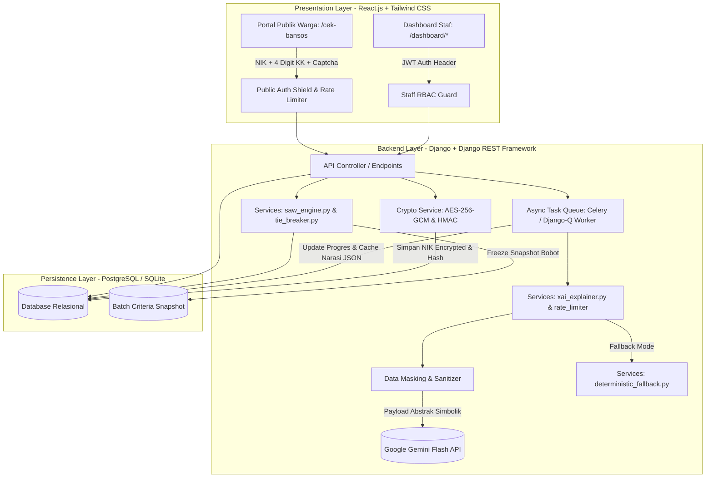
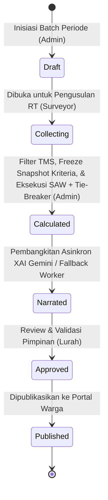
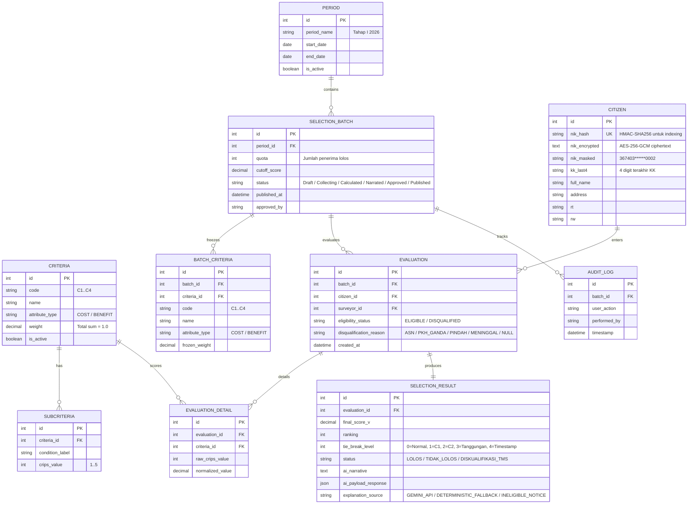

# PROJECT REQUIREMENTS DOCUMENT (PRD) v2.1

**Sistem Pendukung Keputusan Hibrida (SAW + Explainable AI Gemini) Seleksi Bantuan Sosial**  
*Studi Kasus: Kelurahan Jurangmangu Barat, Kecamatan Pondok Aren, Kota Tangerang Selatan*

---

## 1. Ringkasan Eksekutif & Landasan Ilmiah (Overview & Research Novelty)

### 1.1 Latar Belakang & Masalah
Proses seleksi Keluarga Penerima Manfaat (KPM) bansos di tingkat kelurahan selama ini menghadapi dua kendala mendasar:
1. **Subjektivitas & Inkonsistensi:** Penentuan penerima kerap didasarkan pada musyawarah atau pertimbangan intuitif aparat RT/RW tanpa standarisasi matematis yang terukur, sehingga rentan konflik horizontal dan persepsi ketidakadilan.
2. **Ketiadaan Transparansi & "Black-Box Decision":** Warga yang tidak lolos seleksi tidak pernah menerima alasan rasional dan terukur mengapa mereka tidak terpilih, memicu prasangka, kecurigaan manipulasi data, dan komplain berulang ke kantor kelurahan.

### 1.2 Visi Produk
Menghadirkan platform **Explainable Decision Support System (EDSS)** berbasis web hibrida yang memadukan ketegasan matematis algoritma **Simple Additive Weighting (SAW)** dengan empati naratif **Generative AI (Gemini Flash)**:
* **Objektif Matematis:** Perhitungan ranking dan batas kuota penerima manfaat dihitung secara deterministik dan transparan berbasis kriteria terbobot, dilengkapi aturan resolusi skor kembar (*hierarchical tie-breaker*) dan pembekuan bobot kriteria per batch (*criteria snapshot*).
* **Transparan & Edukatif:** Narasi penjelasan individual disajikan secara manusiawi, santun, dan komunikatif dengan pendekatan *Counterfactual Reasoning* (menjelaskan parameter utama pembeda dan memberikan rekomendasi perbaikan kondisi).
* **Zero-Trust Privacy & Kepatuhan UU PDP:** Menjamin 100% data pribadi (PII) warga tidak pernah diekspos ke pihak ketiga atau penyedia LLM melalui arsitektur *data masking & symbolic abstraction*, serta proteksi enkripsi simetris AES-256 at-rest untuk data NIK.

### 1.3 Kebaruan Riset Skripsi (Academic Novelty & Defensibility)
Untuk memastikan nilai akademis yang unggul dalam sidang skripsi, sistem ini memiliki empat kontribusi kebaruan ilmiah:
1. **Hybrid EDSS Architecture:** Mengintegrasikan metode MCDM (Multi-Criteria Decision Making) SAW klasik dengan LLM sebagai *Explainer Layer*, mengubah output matriks numerik menjadi narasi bahasa alami yang ramah bagi warga awam.
2. **Fidelity-Preserving Counterfactual XAI:** Narasi AI diikat secara ketat (*constrained prompt*) agar 100% setia terhadap matriks normalisasi $R_{ij}$ dan bobot preferensi $w_j$, diuji dengan formulasi matematis *Fidelity Score*, serta dilengkapi mekanisme *Deterministic Rule-Based Fallback* jika layanan eksternal mengalami kendala.
3. **Dual-Layer Privacy GovTech Model:** Memisahkan secara tegas portal warga tanpa login yang aman (verifikasi NIK + 4 Digit KK + proteksi Anti-Bot Captcha) dengan dashboard internal aparatur kelurahan berbasis Role-Based Access Control (RBAC).
4. **Asynchronous Scalable Batch Explainer:** Arsitektur worker pemrosesan latar belakang yang menjamin pemrosesan ratusan KPM bebas dari kendala HTTP Gateway Timeout dan rate-limit API LLM.

### 1.4 Ruang Lingkup (In-Scope & Out-of-Scope)
* **In-Scope:**
  * Manajemen kriteria dan sub-kriteria dinamis (cost vs benefit) dengan validasi $\sum w_j = 1.0$ serta mekanisme pembekuan (*criteria snapshot*) per batch seleksi (`BATCH_CRITERIA`).
  * Input manual per warga dan batch import via template Excel resmi, dilengkapi filter gerbang diskualifikasi administratif (*Ineligibility Gate / TMS*).
  * Engine SAW deterministik di layer service backend dengan resolusi skor kembar bertingkat (*hierarchical tie-breaking*).
  * Mesin penjelas XAI Gemini dengan pemrosesan tugas latar belakang (*asynchronous task worker*), kontrol laju (*rate limiting & backoff*), dan teknik sanitasi data anonim.
  * Mesin fallback deterministik berbasis template rule-based (tanpa AI) saat offline/limit.
  * Portal publik warga mandiri dengan verifikasi ganda (NIK + 4 Digit Terakhir No KK), proteksi anti-bot (CAPTCHA ringan), dan proteksi brute-force lockout bertingkat.
  * Enkripsi simetris data sensitif (*encryption at-rest* AES-256-GCM) untuk NIK dan pengindeksan hash HMAC-SHA256.
  * Dashboard staf multi-role (Kasi Kesos, Surveyor RT, Lurah).
  * Generator Berita Acara Kelurahan resmi (PDF dengan QR-Code verifikasi, matriks ranking lolos, dan lampiran warga TMS) dan Ekspor Rekapitulasi Excel.
  * Modul evaluasi komputasi dan instrumen pengujian formal fidelity/hallucination/SUS untuk kebutuhan Bab 4 & 5 Skripsi.
* **Out-of-Scope:**
  * Sinkronisasi data dua arah langsung ke database SIKS-NG nasional Kementerian Sosial (karena keterbatasan hak akses API kementerian).
  * Penyaluran fisik/transaksi finansial bansos.

---

## 2. Target Persona & Matriks Kewenangan (RBAC)

| Role | Target Pengguna | Tanggung Jawab Utama | Lingkungan Akses |
| :--- | :--- | :--- | :--- |
| **Super Admin** | Kasi Kesos (Kepala Seksi Kesejahteraan Sosial) | Konfigurasi kriteria/bobot, inisiasi periode/kuota seleksi, verifikasi data RT, eksekusi SAW, trigger XAI, dan publikasi hasil seleksi. | `/admin/login` & `/dashboard/*` |
| **Surveyor** | Ketua RT / Petugas Lapangan Kelurahan | Input data usulan warga di lingkup wilayahnya, upload Excel batch, verifikasi fakta crips lapangan. | `/admin/login` & `/dashboard/surveyor/*` |
| **Viewer** | Lurah / Sekretaris Kelurahan | Memantau analitik, meninjau transparansi peringkat dan narasi AI, mengesahkan (*Approve*) batch seleksi, unduh Berita Acara. | `/admin/login` & `/dashboard/analytics/*` |
| **Guest** | Warga Pemohon / Publik | Pengecekan mandiri status kelolosan dan narasi XAI transparan dengan memasukkan NIK + 4 digit KK tanpa perlu registrasi akun. | Portal Publik: `/` atau `/cek-bansos` |

---

## 3. Matriks Persyaratan Fungsional (Functional Requirements)

| ID | Modul | Deskripsi Kebutuhan | Kriteria Penerimaan (Definition of Done) |
| :--- | :--- | :--- | :--- |
| **FR-01** | **Manajemen Kriteria Dinamis & Snapshot** | Administrator dapat mengelola kriteria ($C_1 - C_n$), tipe atribut (*cost* / *benefit*), bobot preferensi ($w_j$), dan tabel sub-kriteria crips (skala 1–5). Sistem membekukan bobot kriteria per batch seleksi (`BATCH_CRITERIA`). | Sistem menolak kalkulasi jika total bobot $\sum w_j \neq 1.00$. Saat kalkulasi dimulai, bobot dibekukan ke snapshot batch sehingga perubahan bobot global tidak merusak histori batch lama. |
| **FR-02** | **Ingest Data, Validasi Excel, & Filter TMS** | Mendukung formulir manual per individu dan pengunggahan berkas batch Excel menggunakan template resmi kelurahan. Dilengkapi gerbang diskualifikasi administratif (*Ineligibility Gate*). | Validasi duplikasi NIK 16 digit. Warga dengan status diskualifikasi (ASN/TNI/Polri/PKH ganda/pindah/meninggal) ditandai TMS dan otomatis dikecualikan dari perhitungan SAW namun tetap masuk laporan lampiran TMS. Error Excel spesifik per baris (*chunked parser*). |
| **FR-03** | **SAW Computation Engine & Tie-Breaker** | Kalkulasi matriks keputusan $X$, matriks ternormalisasi $R$, dan nilai preferensi $V_i = \sum (w_j \cdot r_{ij})$ secara matematis di layer service backend dengan aturan penentu skor kembar (*hierarchical tie-breaking*). | Perhitungan 100% akurat. Otomatis menentukan klasifikasi status: Ranking $1 \dots N$ (Kuota) = **Lolos**, Ranking $> N$ = **Tidak Lolos**. Jika terjadi skor $V_i$ kembar di batas kuota, tie-breaker bertingkat dieksekusi secara deterministik (C1 -> C2 -> tanggungan riil -> timestamp pengusulan). |
| **FR-04** | **Counterfactual XAI & Async Worker** | Pembangkitan narasi penjelasan individual menggunakan Gemini API secara asinkron (*background worker*) dengan kontrol laju (*rate limiting & backoff*) dan abstraksi simbolik. | Data identitas pribadi di-masking 100%. Pembangkitan batch berjalan di latar belakang (tidak blocking HTTP) dengan pemantau progres real-time. Narasi menjelaskan faktor pembeda utama dan saran konstruktif jika tidak lolos. |
| **FR-05** | **Deterministic Fallback Engine** | Mekanisme cadangan berbasis template aturan matematis (*rule-based text generator*) jika pemanggilan Gemini API gagal, timeout, atau kuota habis. | Sistem tidak pernah menampilkan *error 500* kepada pengguna. Jika API Gemini offline atau rate limit terlampaui, narasi fallback berbasis komparasi nilai rata-rata otomatis terbit tanpa menghentikan batch. |
| **FR-06** | **Portal Publik Verifikasi Ganda & Anti-Bot** | Portal pencarian status bansos mandiri tanpa autentikasi login akun, dilindungi verifikasi NIK (16 digit) + 4 digit terakhir No KK, proteksi CAPTCHA anti-bot, dan enkripsi data at-rest. | Proteksi IP rate-limiting maks 5 request/menit dan CAPTCHA ringan. Lockout 15 menit jika 5 kali gagal berturut-turut pada NIK yang sama. Menampilkan kartu hasil interaktif dengan status, narasi XAI, dan visualisasi selisih nilai kriteria. |
| **FR-07** | **Pelaporan & Berita Acara Digital** | Cetak Lembar Hasil Pengecekan Individu (PDF) untuk warga dan Berita Acara Penetapan Penerima Bansos resmi (PDF + Excel rekap) untuk kelurahan. | PDF Berita Acara dilengkapi kop surat resmi kelurahan, tanda tangan elektronik / QR Code verifikasi integritas data, matriks ranking lolos, dan lampiran warga TMS. NIK didekripsi hanya untuk cetak dokumen resmi kelurahan. |
| **FR-08** | **Modul Evaluasi Akademik (Skripsi)** | Halaman khusus admin/analis untuk menguji metrik performa sistem: akurasi SAW, waktu komputasi, metrik matematis Fidelity XAI, dan instrumen SUS/TAM. | Menghitung Fidelity Score matematis berbasis jarak normalisasi terbobot, Hallucination Rate, serta mengekspor dataset perbandingan skor dan template kuesioner evaluasi kegunaan sistem (SUS / TAM). |

---

## 4. Arsitektur Sistem & Prinsip Keamanan Data



### 4.1 Prinsip Zero-Trust Privacy & Enkripsi Data At-Rest (Kepatuhan UU PDP)
Untuk menjamin kerahasiaan data kependudukan sesuai amanat UU No. 27 Tahun 2022 tentang Perlindungan Data Pribadi:
1. **Enkripsi At-Rest (AES-256-GCM):** NIK 16-digit asli disimpan dalam bentuk terenkripsi simetris menggunakan algoritma **AES-256-GCM** (`nik_encrypted`). Kunci enkripsi tersimpan di *environment variable* server (bukan di database). NIK asli hanya didekripsi saat aparat kelurahan mencetak Berita Acara resmi untuk verifikasi fisik di loket.
2. **Pencarian Terindeks Cepat (HMAC-SHA256):** Untuk pencarian tanpa membongkar dekripsi massal, sistem menggunakan `nik_hash` dengan algoritma **HMAC-SHA256** dan *server-side pepper* rahasia, mencegah serangan *rainbow table*.
3. **Sanitasi Total Sebelum AI:** Service backend membuang seluruh PII sebelum membuat payload Gemini API. Variabel yang dikirim hanya:
   * Kode Anonim Pemohon (misal: `Pemohon #A-17`)
   * Peringkat Akhir ($Rank$) dan Kuota Tersedia ($N$)
   * Nilai Matriks Ternormalisasi per Kriteria ($r_{ij} \in [0, 1]$)
   * Bobot Preferensi Beku ($w_j$) dan Tipe Kriteria (*cost* / *benefit*)
   * Rata-rata Skor KPM Lolos Kuota sebagai pembanding counterfactual
4. **Restitusi Identitas Terisolasi:** Teks narasi dari Gemini disimpan terpisah dalam database dan baru digabungkan dengan `name_masked` dan `nik_masked` saat dipresentasikan ke antarmuka pengguna.

### 4.2 Proteksi Portal Publik Warga & Pencegahan Brute-Force
* **Verifikasi Ganda:** Memeriksa kesesuaian **16 Digit NIK** dan **4 Digit Terakhir No KK**.
* **Anti-Bot Captcha:** Integrasi tantangan CAPTCHA ringan (Cloudflare Turnstile atau Math Captcha dinamis) pada form pencarian publik untuk memblokir bot otomatis.
* **Dual-Tier Rate Limiting:**
  1. *IP Rate Limiting:* Dibatasi maksimal 5 request/menit per IP via Django Cache.
  2. *NIK-Specific Account Lockout:* Jika kombinasi 4 digit KK untuk NIK tertentu gagal 5 kali berturut-turut, pencarian untuk NIK tersebut dikunci sementara selama 15 menit untuk memitigasi serangan brute-force dictionary.
* **Masking Visual:** Pada tampilan hasil pencarian, NIK dan Nama disamarkan sebagian (contoh: `367403******0002` dan `Budi S******`).

### 4.3 Arsitektur Pemrosesan Latar Belakang (Asynchronous XAI Worker)
Untuk mencegah kegagalan HTTP Timeout pada batch besar (100–300 KPM) dan mengelola batas pemanggilan API eksternal:
* Pemanggilan generator narasi dijalankan via *asynchronous worker queue* (Django-Q / Celery).
* Worker mengontrol *delay throttling* terukur antar-request (mematuhi RPM limit Google Gemini).
* Jika ada request individual yang gagal atau mencapai limit setelah 2 kali *exponential backoff*, worker secara otomatis mengalihkan KPM tersebut ke `deterministic_fallback.py` tanpa menghentikan antrean.
* Frontend memantau progres secara berkala (*polling*) melalui endpoint `/api/selection/{batch_id}/xai-progress/`.

---

## 5. Mesin Status Seleksi (State Machine)

Siklus hidup setiap periode seleksi bansos diatur dalam alur status yang tegas untuk mencegah kebocoran data sebelum waktunya:



1. **`Draft`:** Periode seleksi dibuat oleh Kasi Kesos; kriteria, bobot awal, dan kuota kuantitatif ditentukan.
2. **`Collecting`:** Surveyor (Ketua RT) memasukkan atau mengunggah data usulan calon KPM serta menandai warga yang tidak memenuhi syarat (*TMS*).
3. **`Calculated`:** Kasi Kesos menutup masa usulan. Sistem memfilter warga diskualifikasi (TMS), membekukan snapshot kriteria ke tabel `BATCH_CRITERIA`, dan menjalankan engine SAW dengan *hierarchical tie-breaker*. Nilai $V_i$, ranking definitif, dan status kelolosan sementara terbentuk.
4. **`Narrated`:** Sistem menjalankan *asynchronous task worker* untuk membangkitkan narasi penjelasan XAI secara bertahap bagi seluruh calon KPM (progres dapat dipantau real-time, hasil di-cache di database).
5. **`Approved`:** Lurah memeriksa rekapitulasi, meninjau uji petik transparansi narasi, menandatangani Berita Acara resmi, dan menyetujui hasil seleksi.
6. **`Published`:** Hasil seleksi aktif di portal publik. Warga dapat mengecek kelulusan dan narasinya secara transparan melalui verifikasi NIK + 4 digit KK + Captcha.

---

## 6. Detail Activity Flow per Role

### A. Super Admin (Kasi Kesos)
1. **Login & Inisialisasi:** Mengakses `/admin/login`, membuat periode bansos baru (contoh: "Bansos Sembako Tahap II 2026"), dan menentukan kuota penerima ($N = 50$).
2. **Penyesuaian Kriteria:** Meninjau bobot $w_j$ ($C_1$ Pendapatan, $C_2$ Tanggungan, $C_3$ Kondisi Rumah, $C_4$ Aset). Sistem memvalidasi $\sum w_j = 1.0$.
3. **Verifikasi Data Lapangan & TMS:** Memeriksa agregat usulan dari RT 01 s/d RT 10 serta memvalidasi daftar warga yang didiskualifikasi administratif (ASN/TNI/Polri/PKH ganda).
4. **Kalkulasi SAW & Freeze Snapshot:** Menekan tombol *"Hitung Seleksi SAW"*. Sistem membekukan bobot kriteria ke `BATCH_CRITERIA`, mengkalkulasi matriks normalisasi, menerapkan *hierarchical tie-breaking* bila terdapat skor kembar di batas kuota, dan menghasilkan pemeringkatan dalam $< 2$ detik.
5. **Pembangkitan XAI Asinkron:** Menekan tombol *"Generate Penjelasan XAI (Batch)"*. Sistem mendaftarkan antrean tugas ke background worker, menampilkan bilah kemajuan (*progress bar*) persentase penyelesaian, dan menangani fallback otomatis jika terjadi limit API.
6. **Pengajuan Pengesahan:** Mengirim draf Berita Acara digital ke akun Lurah.
7. **Publikasi:** Mengubah status batch menjadi `Published` setelah Lurah memberikan approval.

### B. Surveyor (Ketua RT / Petugas Lapangan)
1. **Login Terbatas:** Masuk dengan akun wilayah RT masing-masing.
2. **Input Usulan & Flagging:**
   * *Opsi 1:* Formulir entri per individu warga dengan dropdown sub-kriteria crips (1–5) serta opsi menandai status kelayakan (Eligible / TMS).
   * *Opsi 2:* Unduh template Excel `template_usulan_bansos_rt.xlsx`, mengisi data warga, dan mengunggahnya.
3. **Audit Validasi:** Memperbaiki data jika sistem menemukan format NIK keliru atau data duplikat.
4. **Finalisasi Usulan:** Menandai usulan wilayahnya sebagai *"Selesai Diusulkan"*.

### C. Viewer (Lurah / Pimpinan)
1. **Monitoring Eksekutif:** Membuka dashboard analitik grafik sebaran nilai preferensi, kuota per-RT, rasio kelayakan, dan daftar warga TMS.
2. **Uji Petik Transparansi:** Membuka rincian narasi XAI calon KPM peringkat teratas dan calon KPM tepat di bawah batas kuota (*borderline cases*) untuk memastikan ketiadaan manipulasi.
3. **Pengesahan Digital:** Menekan tombol *"Approve & Sahkan Seleksi"*, yang secara otomatis menerbitkan Berita Acara resmi berkode QR unik.

### D. Guest (Warga Pemohon / Publik)
1. **Akses Portal:** Membuka URL publik `/` atau `/cek-bansos`.
2. **Input Verifikasi:** Memasukkan 16 Digit NIK, 4 Digit Terakhir No KK, dan menyelesaikan tantangan CAPTCHA ringan.
3. **Pemeriksaan Hasil:**
   * Jika batch berstatus `Published`: Menampilkan kartu keputusan resmi (Lolos / Belum Lolos), skor preferensi, narasi pertimbangan bahasa Indonesia yang santun, dan grafik visual perbandingan kriteria.
   * Jika NIK terdaftar sebagai diskualifikasi administratif: Menampilkan informasi santun terkait alasan ketidaksesuaian administratif (TMS).
   * Jika belum dipublikasikan atau data tidak ditemukan: Menampilkan pesan informatif yang ramah.
4. **Unduh Bukti:** Warga dapat mengunduh atau mencetak Lembar Transparansi Keputusan format PDF.

---

## 7. Desain Spesifikasi XAI & Prompt Engineering

### 7.1 Format Payload Anonim ke Gemini API
Payload dikirim ke Gemini 2.5/3.0 Flash dengan konfigurasi `temperature: 0.15` dan `response_mime_type: "application/json"`.

```json
{
  "applicant_code": "KPM-042",
  "rank": 35,
  "quota": 30,
  "status": "TIDAK_LOLOS",
  "final_score": 0.684,
  "cutoff_score": 0.725,
  "criteria_data": [
    {
      "code": "C1",
      "name": "Pendapatan Keluarga",
      "type": "COST",
      "weight": 0.30,
      "raw_crips_label": "Rp 1.500.000 - Rp 2.500.000",
      "normalized_score": 0.60,
      "avg_passed_score": 0.85
    },
    {
      "code": "C2",
      "name": "Jumlah Tanggungan",
      "type": "BENEFIT",
      "weight": 0.25,
      "raw_crips_label": "2 Orang",
      "normalized_score": 0.50,
      "avg_passed_score": 0.80
    },
    {
      "code": "C3",
      "name": "Kondisi Tempat Tinggal",
      "type": "BENEFIT",
      "weight": 0.25,
      "raw_crips_label": "Rumah Semi Permanen",
      "normalized_score": 0.75,
      "avg_passed_score": 0.75
    },
    {
      "code": "C4",
      "name": "Kepemilikan Aset",
      "type": "COST",
      "weight": 0.20,
      "raw_crips_label": "Memiliki 1 Motor Roda Dua",
      "normalized_score": 0.70,
      "avg_passed_score": 0.70
    }
  ]
}
```

### 7.2 System Instruction untuk Gemini
```text
Anda adalah asisten resmi Dinas Sosial Kelurahan Jurangmangu Barat yang bertugas memberikan penjelasan transparansi keputusan seleksi bantuan sosial berdasarkan kalkulasi matematis Simple Additive Weighting (SAW).

Pedoman Komunikasi & Output:
1. Bersikaplah objektif, empati, santun, dan solutif. Jangan pernah menggunakan kata-kata yang mendiskreditkan warga.
2. Rujuk pemohon sebagai "Bapak/Ibu Pemohon". Jangan pernah mengarang data identitas di luar parameter JSON.
3. Jika status pemohon 'TIDAK_LOLOS':
   - Jelaskan bahwa pemohon berada di peringkat {rank} dari kuota {quota} penerima manfaat yang tersedia pada periode ini.
   - Lakukan analisis counterfactual: sebutkan 1 atau 2 kriteria yang menjadi faktor pembeda utama (jarak skor normalisasi terbesar dibanding rata-rata penerima yang lolos kuota).
   - Berikan rekomendasi edukatif yang konstruktif (misal: jika ada pemutakhiran data kondisi tanggungan atau ekonomi di masa mendatang, dapat melapor ke pihak RT untuk periode seleksi selanjutnya).
4. Jika status pemohon 'LOLOS':
   - Ucapkan selamat dan jelaskan kriteria apa yang menjadi pertimbangan prioritas utama sesuai bobot preferensi kelurahan.
   - Ingatkan jadwal verifikasi fisik berkas atau penyaluran di kantor kelurahan.
5. Keluarkan output dalam format JSON valid dengan field:
   - "ringkasan_keputusan": string (1 kalimat formal)
   - "faktor_penentu_utama": list of string
   - "narasi_lengkap": string (2-3 paragraf bahasa Indonesia mengalir)
   - "rekomendasi_tindak_lanjut": string
```

### 7.3 Logika Fallback Deterministik (Offline Engine)
Jika pemanggilan API eksternal gagal setelah 2 kali percobaan (*retry* dengan *backoff* 3 detik), sistem memanggil fungsi `generate_deterministic_fallback()`:
* **Analisis Gap:** Menghitung selisih $\Delta_j = \text{avg\_passed\_score}_j - \text{normalized\_score}_j$.
* **Penyusunan Template String:** Memilih kriteria dengan $\Delta_j$ terbesar dan menyusun teks resmi terstandarisasi kelurahan secara otomatis tanpa ada jeda waktu kegagalan sistem.

---

## 8. Skema Basis Data Relasional



---

## 9. Kontrak API Inti (API Contracts)

### 9.1 Autentikasi Staf
* **`POST /api/auth/login/`**
  * *Request Body:* `{"username": "kasi_kesos", "password": "***"}`
  * *Response 200:* `{"access": "token_jwt...", "refresh": "...", "role": "SUPER_ADMIN", "name": "Budi Hartono, S.Sos"}`

### 9.2 Manajemen Kriteria
* **`GET /api/criteria/`** & **`PUT /api/criteria/batch-update/`**
  * *Request Body (PUT):*
    ```json
    {
      "criteria": [
        {"id": 1, "weight": 0.30, "attribute_type": "COST"},
        {"id": 2, "weight": 0.25, "attribute_type": "BENEFIT"},
        {"id": 3, "weight": 0.25, "attribute_type": "BENEFIT"},
        {"id": 4, "weight": 0.20, "attribute_type": "COST"}
      ]
    }
    ```
  * *Response 200:* `{"message": "Kriteria berhasil diperbarui. Total bobot: 1.00"}`
  * *Response 400:* `{"error": "Validasi gagal: Total bobot harus persis bernilai 1.00 (Total saat ini: 0.95)"}`

### 9.3 Ingest Data Warga
* **`POST /api/citizens/import-excel/`**
  * *Headers:* `Authorization: Bearer <token>`, `Content-Type: multipart/form-data`
  * *Payload:* File `.xlsx`
  * *Response 200:* `{"total_imported": 85, "duplicates_skipped": 2, "errors": []}`

### 9.4 Eksekusi SAW Engine & XAI
* **`POST /api/selection/{batch_id}/calculate/`**
  * *Auth:* Super Admin
  * *Response 200:*
    ```json
    {
      "batch_id": 12,
      "total_candidates": 100,
      "eligible_candidates": 96,
      "disqualified_tms": 4,
      "quota": 30,
      "cutoff_score": 0.7250,
      "tie_breaks_resolved": 2,
      "status": "Calculated",
      "execution_time_ms": 42
    }
    ```

* **`POST /api/selection/{batch_id}/generate-xai/`**
  * *Auth:* Super Admin
  * *Query Params:* `?mode=batch` atau `?evaluation_id=45`
  * *Response 202 Accepted:*
    ```json
    {
      "job_id": "job_xai_batch_12_f7a8b",
      "batch_id": 12,
      "status": "QUEUED",
      "message": "Pembangkitan narasi XAI telah didaftarkan ke antrean background worker."
    }
    ```

* **`GET /api/selection/{batch_id}/xai-progress/`**
  * *Auth:* Super Admin / Viewer
  * *Response 200:*
    ```json
    {
      "batch_id": 12,
      "status": "PROCESSING",
      "total_candidates": 96,
      "processed_count": 64,
      "gemini_success": 62,
      "fallback_used": 2,
      "progress_percent": 66.7,
      "is_completed": false
    }
    ```

### 9.5 Pengesahan & Publikasi
* **`PATCH /api/selection/{batch_id}/approve/`** (Viewer / Lurah)
* **`PATCH /api/selection/{batch_id}/publish/`** (Super Admin)

### 9.6 Portal Publik Warga (Unauthenticated)
* **`POST /api/public/check-status/`**
  * *Rate Limit:* 5 req/menit/IP + Proteksi Brute-Force Lockout per NIK
  * *Request Body:*
    ```json
    {
      "nik": "3674031208850002",
      "kk_last4": "5501",
      "captcha_token": "cf_turnstile_response_token_here"
    }
    ```
  * *Response 200 (Contoh: Tidak Lolos):*
    ```json
    {
      "found": true,
      "period_name": "Bansos Sembako Tahap I 2026",
      "applicant": {
        "nik_masked": "367403******0002",
        "name_masked": "Ahmad S******",
        "rt": "003",
        "rw": "001"
      },
      "result": {
        "status": "TIDAK_LOLOS",
        "rank": 35,
        "quota": 30,
        "final_score": 0.6840,
        "cutoff_score": 0.7250,
        "explanation": {
          "ringkasan": "Berdasarkan pemeringkatan kriteria terbobot, usulan bantuan belum masuk dalam kuota 30 penerima pada periode seleksi ini.",
          "faktor_utama": [
            "Nilai kriteria Pendapatan Keluarga berada di atas batas prioritas penerima",
            "Kapasitas tanggungan keluarga belum memenuhi ambang prioritas tertinggi"
          ],
          "narasi_lengkap": "Berdasarkan hasil musyawarah seleksi objektif Kelurahan Jurangmangu Barat periode Tahap I 2026, berkas Bapak/Ibu Pemohon berada pada peringkat 35 dari alokasi kuota 30 penerima manfaat...",
          "rekomendasi": "Apabila terdapat perubahan data kependudukan atau kondisi ekonomi terkini, silakan berkoordinasi dengan Ketua RT setempat untuk pemutakhiran data pada periode seleksi berikutnya."
        },
        "chart_data": [
          {"kriteria": "Pendapatan", "skor_pemohon": 0.60, "rata_rata_lolos": 0.85},
          {"kriteria": "Tanggungan", "skor_pemohon": 0.50, "rata_rata_lolos": 0.80},
          {"kriteria": "Kondisi Rumah", "skor_pemohon": 0.75, "rata_rata_lolos": 0.75},
          {"kriteria": "Aset", "skor_pemohon": 0.70, "rata_rata_lolos": 0.70}
        ]
      }
    }
    ```
  * *Response 403:* `{"error": "Verifikasi CAPTCHA gagal atau kedaluwarsa. Silakan ulangi kembali."}`
  * *Response 429:* `{"error": "Pencarian untuk NIK ini dikunci sementara selama 15 menit akibat 5 kali kegagalan verifikasi berturut-turut."}`
  * *Response 404:* `{"found": false, "message": "Kombinasi NIK dan 4 digit No KK tidak ditemukan pada periode seleksi aktif."}`

---

## 10. Instrumen & Metrik Pengujian Skripsi (Bab 4 & 5 Ready)

Untuk menjamin skripsi ini lulus dengan nilai tertinggi dan siap diuji secara ilmiah oleh dosen penguji, sistem mengintegrasikan empat instrumen evaluasi formal:

### 10.1 Uji Validitas Komputasi SAW & Resolusi Tie-Breaker (Akurasi 100%)
* **Metode:** Pengujian *White-box & Unit Testing* membandingkan hasil manual Microsoft Excel terhadap output service `saw_engine.py` pada 100 data uji KPM.
* **Pengujian Kasus Kembar (*Tie-Break Test*):** Menguji data sintetis dengan nilai preferensi $V_i$ identik di garis kuota untuk memastikan sistem mengeksekusi aturan bertingkat (C1 -> C2 -> tanggungan -> timestamp) secara 100% deterministik.
* **Target Metrik:** Persentase kecocokan nilai preferensi $V_i$ dan urutan peringkat mencapai **100% (Error = 0.0000)**.

### 10.2 Uji Kualitas & Kesetiaan Narasi XAI (Fidelity & Hallucination Rate)
* **Formulasi Formal Fidelity Score:**
  Mengukur apakah kriteria yang diidentifikasi oleh LLM sebagai faktor utama ketidaklolosan benar-benar merupakan atribut dengan penalti kesenjangan terbobot terbesar:
  $$\text{Fidelity Score} = \frac{1}{|K_{\text{TL}}|} \sum_{i \in K_{\text{TL}}} \mathbb{I}\left( C_{\text{AI\_primary}}(i) == \operatorname{argmax}_j (\Delta_{i,j} \cdot w_j) \right)$$
  * Dimana:
    * $K_{\text{TL}}$: Himpunan calon KPM yang berstatus Tidak Lolos.
    * $\Delta_{i,j} = \bar{r}_j^{\text{lolos}} - r_{ij}$ (selisih skor normalisasi kandidat $i$ terhadap rata-rata penerima yang lolos pada kriteria $j$).
    * $w_j$: Bobot kriteria beku dari `BATCH_CRITERIA`.
    * $\mathbb{I}(\cdot)$: Fungsi indikator (bernilai 1 jika kondisi benar, 0 jika salah).
* **Formulasi Formal Hallucination Rate:**
  $$H_{\text{rate}} = \frac{N_{\text{invalid}}}{N_{\text{total}}} \times 100\%$$
  * Di mana $N_{\text{invalid}}$ adalah jumlah narasi yang menyebutkan nama kriteria di luar daftar $\{C_1, \dots, C_n\}$ atau memuat nilai numerik fiktif yang tidak terdapat pada payload JSON input.
* **Target Metrik:** *Hallucination Rate* = 0.0%, *Fidelity Alignment* $\ge 95.0\%$.

### 10.3 Uji Efisiensi & Ketahanan Asinkron (Stress Testing)
* **Metode:** Mengukur stabilitas pemrosesan batch 100 KPM:
  * Waktu total pemrosesan asinkron ($T_{\text{total}}$).
  * Persentase pemanggilan sukses Gemini API vs pengalihan ke Deterministic Fallback Engine.
  * Memverifikasi ketiadaan HTTP 504 Timeout pada sisi klien web.

### 10.4 Uji Penerimaan Pengguna (System Usability Scale - SUS)
* **Responden:** 3 Staf Kelurahan (Kasi Kesos & staf), 5 Ketua RT, dan 15 Warga Jurangmangu Barat.
* **Instrumen:** Kuesioner 10 butir pertanyaan standar SUS untuk mengevaluasi transparansi dan kejelasan sistem.
* **Target Metrik:** Skor SUS rata-rata $\ge 80.0$ (Kategori *Grade A / Excellent*).

---

## 11. Daftar Hal yang Tidak Dikerjakan (Not Doing & Trade-Offs)

Fokus adalah kunci keberhasilan rekayasa perangkat lunak. Batasan berikut sengaja ditetapkan:
1. **Tidak Ada Fitur Akun Login untuk Warga:** Warga tidak perlu mendaftar akun, mengingat tingginya friksi pendaftaran dan risiko lupa sandi di kalangan warga lansia. Verifikasi NIK + 4 digit KK dengan proteksi Captcha jauh lebih efektif.
2. **Tidak Ada Jalur Sanggahan Dua Arah di Portal Publik:** Warga tidak mengunggah berkas sanggahan langsung ke web untuk menghindari beban verifikasi berkas digital di server kelurahan. Sanggahan diarahkan secara kultural melalui Ketua RT saat pemutakhiran periode berikutnya.
3. **Tidak Menghubungkan Langsung ke Server Kemensos (SIKS-NG):** Akses database SIKS-NG dilindungi regulasi nasional yang ketat. Sistem ini diposisikan sebagai *Decision Support System* otonom tingkat kelurahan guna menghasilkan data usulan yang solid sebelum dimasukkan ke form SIKS-NG oleh operator.
4. **Tidak Menggunakan Model LLM Lokal Berat (Self-Hosted LLM):** Server kelurahan tidak memiliki GPU khusus. Menggunakan API Gemini Flash melalui cloud dengan enkripsi, pemrosesan asinkron, dan *data masking* 100% jauh lebih hemat biaya, cepat, dan realistis.

---

## 12. Rencana Implementasi & Milestone Teknis

| Tahap | Aktivitas Utama | Output Konkret |
| :--- | :--- | :--- |
| **Milestone 1** | Setup Lingkungan, Model DB Django (`BATCH_CRITERIA`, `nik_encrypted`), & Fixtures Kriteria | Migrasi database selesai, modul enkripsi AES-256 aktif, data kriteria $C_1 - C_4$ terisi. |
| **Milestone 2** | Service `saw_engine.py`, `tie_breaker.py`, & Otomasi Unit Test Komputasi | Modul perhitungan SAW teruji 100% identik dengan hitungan manual Excel beserta uji skor kembar. |
| **Milestone 3** | Service `xai_explainer.py`, Task Worker Asinkron (Django-Q/Celery), Rate Limiting, & Fallback Engine | Pembangkitan narasi asinkron dengan polling progres real-time dan mitigasi error 429/timeout. |
| **Milestone 4** | Portal Publik Warga (Captcha + Rate Limit Lockout) & Dashboard Staf Internal | UI responsif, form NIK + 4 digit KK aman, visualisasi gap kriteria radar/bar chart. |
| **Milestone 5** | Generator Laporan PDF (Berita Acara + Lampiran TMS) & Excel Rekapitulasi | Ekspor dokumen resmi kelurahan dengan QR Code dan pemisahan warga TMS. |
| **Milestone 6** | Pengujian Formal Skripsi & Penyusunan Bab 4 Skripsi | Hasil uji akurasi SAW, uji metrik matematis Fidelity XAI, uji beban asinkron, dan laporan SUS. |