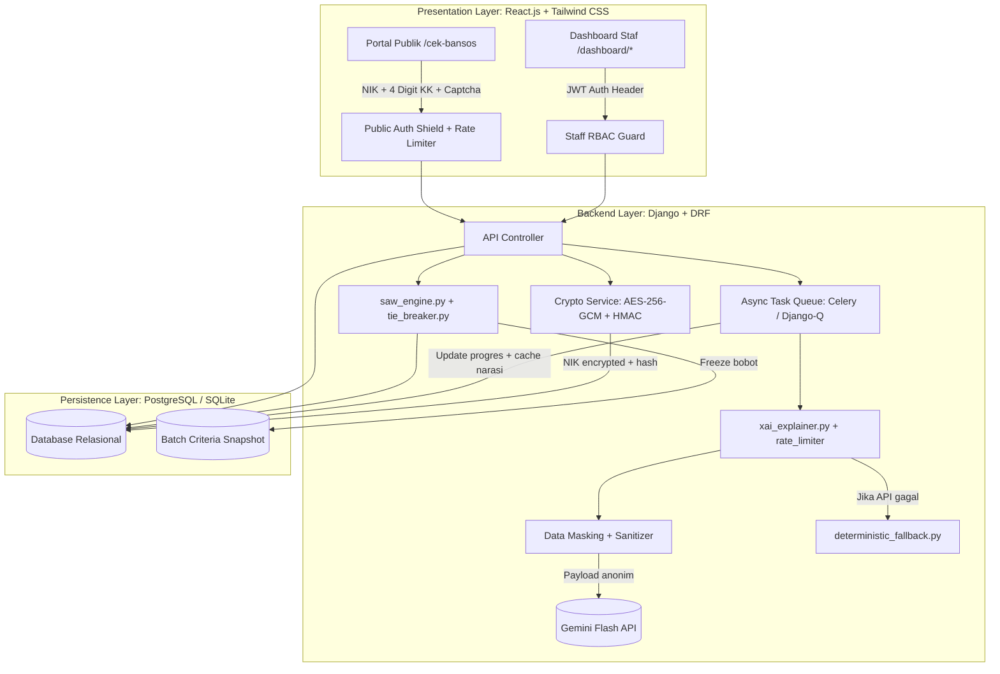
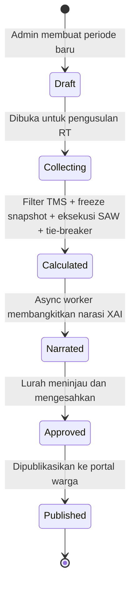
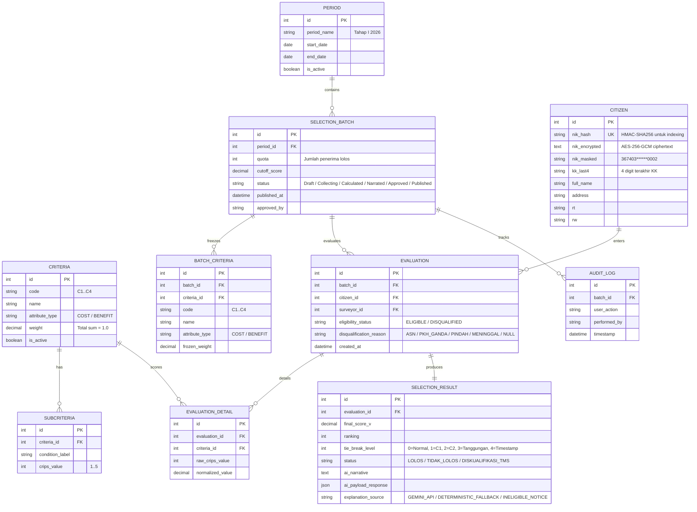

# PROJECT REQUIREMENTS DOCUMENT (PRD) v3.0 Final

**Sistem Pendukung Keputusan Hibrida (SAW + Explainable AI Gemini) untuk Seleksi Bantuan Sosial**
*Studi Kasus: Kelurahan Jurangmangu Barat, Kecamatan Pondok Aren, Kota Tangerang Selatan*

---

## 1. Tujuan dan Masalah yang Diselesaikan

### 1.1 Masalah

Seleksi Keluarga Penerima Manfaat (KPM) bansos di tingkat kelurahan memiliki dua masalah utama:

1. **Seleksi tanpa standar matematis.** Penentuan penerima didasarkan pada musyawarah atau pertimbangan intuitif aparat RT/RW. Proses ini tidak terukur, rentan konflik horizontal, dan menghasilkan persepsi ketidakadilan antar-warga.
2. **Warga tidak tahu alasan penolakan.** Calon KPM yang tidak lolos tidak pernah menerima penjelasan terukur tentang penyebab ketidaklolosan mereka. Akibatnya muncul prasangka, kecurigaan manipulasi data, dan keluhan berulang ke kantor kelurahan.

### 1.2 Solusi

Sistem ini membangun platform web yang menggabungkan algoritma **Simple Additive Weighting (SAW)** untuk perankingan matematis dengan **Gemini Flash API** untuk menghasilkan narasi penjelasan keputusan dalam bahasa Indonesia.

Sistem melakukan tiga hal:
- Menghitung ranking calon KPM berdasarkan kriteria terbobot secara deterministik dan transparan.
- Menghasilkan narasi penjelasan per individu yang menjelaskan faktor pembeda utama dan rekomendasi perbaikan, tanpa mengirimkan data pribadi ke API eksternal.
- Menyediakan portal publik tempat warga mengecek status kelolosan tanpa perlu membuat akun.

### 1.3 Kebaruan Riset Skripsi

Sistem ini memiliki empat kontribusi akademis:

1. **Arsitektur EDSS Hibrida.** Integrasi metode MCDM SAW klasik dengan LLM sebagai *Explainer Layer*. Output matriks numerik diubah menjadi narasi bahasa alami yang dapat dipahami warga awam.
2. **Counterfactual XAI dengan Kontrol Kesetiaan.** Narasi AI dikunci oleh *constrained prompt* agar setia terhadap matriks normalisasi $R_{ij}$ dan bobot preferensi $w_j$. Kesetiaan diuji menggunakan formulasi matematis *Fidelity Score*. Jika layanan AI gagal, sistem menggunakan generator teks deterministik berbasis aturan.
3. **Model Privasi Dua Lapis untuk GovTech.** Portal warga tanpa login (verifikasi NIK + 4 digit KK + CAPTCHA) dipisahkan dari dashboard internal staf kelurahan yang menggunakan RBAC. Data NIK dienkripsi dengan AES-256-GCM sesuai UU PDP.
4. **Pemrosesan Batch Asinkron.** Arsitektur worker latar belakang yang memproses ratusan KPM tanpa memicu HTTP Gateway Timeout atau melampaui batas panggilan API.

### 1.4 Ruang Lingkup

**Yang dibangun:**
- Manajemen kriteria dinamis (cost/benefit) dengan validasi $\sum w_j = 1.0$ dan pembekuan bobot per batch (*criteria snapshot* ke `BATCH_CRITERIA`).
- Input data per individu dan batch import Excel, dengan gerbang diskualifikasi administratif (Tidak Memenuhi Syarat / TMS).
- Engine SAW deterministik dengan resolusi skor kembar bertingkat (*hierarchical tie-breaking*).
- Generator narasi XAI via Gemini API, dijalankan sebagai *asynchronous task worker* dengan kontrol laju dan *exponential backoff*.
- Generator narasi fallback deterministik (tanpa AI) saat API offline atau limit tercapai.
- Portal publik warga: verifikasi NIK + 4 digit terakhir No KK + CAPTCHA ringan + lockout brute-force.
- Enkripsi NIK: AES-256-GCM (*at-rest*) dan HMAC-SHA256 (*indexing*).
- Dashboard staf multi-role (Kasi Kesos, Surveyor RT, Lurah).
- Generator Berita Acara resmi (PDF + QR Code + lampiran warga TMS) dan ekspor Excel.
- Modul evaluasi formal: uji akurasi SAW, metrik Fidelity/Hallucination, dan instrumen SUS.

**Yang tidak dibangun:**
- Sinkronisasi dua arah ke database SIKS-NG Kementerian Sosial (keterbatasan hak akses API nasional).
- Penyaluran fisik atau transaksi finansial bansos.

---

## 2. Tech Stack

| Lapisan | Teknologi |
| :--- | :--- |
| Frontend | React.js, Tailwind CSS |
| Backend | Django 5.x, Django REST Framework |
| Database | PostgreSQL (produksi) / SQLite (pengembangan) |
| Task Queue | Django-Q atau Celery + Redis |
| AI API | Google Gemini Flash (2.5/3.0) |
| Enkripsi | AES-256-GCM (at-rest), HMAC-SHA256 (indexing) |
| PDF Generator | ReportLab / WeasyPrint |
| Auth | JWT (SimpleJWT) untuk staf, verifikasi NIK+KK untuk publik |

---

## 3. Persona dan Kewenangan (RBAC)

| Role | Pengguna | Tanggung Jawab | Akses |
| :--- | :--- | :--- | :--- |
| Super Admin | Kasi Kesos | Konfigurasi kriteria/bobot, inisiasi periode/kuota, verifikasi data RT, eksekusi SAW, trigger XAI, publikasi hasil. | `/admin/login`, `/dashboard/*` |
| Surveyor | Ketua RT / Petugas Lapangan | Input usulan warga, upload Excel batch, verifikasi data lapangan, flagging TMS. | `/admin/login`, `/dashboard/surveyor/*` |
| Viewer | Lurah / Sekretaris Kelurahan | Monitoring analitik, uji petik transparansi narasi, pengesahan batch, unduh Berita Acara. | `/admin/login`, `/dashboard/analytics/*` |
| Guest | Warga Pemohon | Cek status kelolosan dan baca narasi penjelasan via NIK + 4 digit KK. Tanpa registrasi akun. | `/`, `/cek-bansos` |

---

## 4. Persyaratan Fungsional

| ID | Modul | Deskripsi | Kriteria Penerimaan |
| :--- | :--- | :--- | :--- |
| FR-01 | Manajemen Kriteria dan Snapshot | Admin mengelola kriteria ($C_1$ s/d $C_n$), tipe atribut (cost/benefit), bobot ($w_j$), dan sub-kriteria crips (skala 1-5). Sistem membekukan bobot ke `BATCH_CRITERIA` saat kalkulasi dimulai. | Kalkulasi ditolak jika $\sum w_j \neq 1.00$. Perubahan bobot setelah kalkulasi tidak mengubah data batch lama. |
| FR-02 | Ingest Data dan Filter TMS | Formulir manual per individu dan upload batch Excel. Gerbang diskualifikasi untuk warga TMS (ASN/TNI/Polri, PKH ganda, pindah, meninggal). | Validasi duplikasi NIK 16 digit. Warga TMS dikecualikan dari SAW, tetap masuk lampiran laporan. Error Excel dilaporkan per baris. |
| FR-03 | SAW Engine dan Tie-Breaker | Kalkulasi matriks $X$, normalisasi $R$, dan preferensi $V_i = \sum (w_j \cdot r_{ij})$. Resolusi skor kembar di batas kuota. | Akurasi 100% terhadap hitungan manual. Tie-breaker deterministik: nilai $r$ pada C1 terbesar, lalu C2, lalu jumlah tanggungan riil, lalu timestamp pengusulan. |
| FR-04 | XAI Asinkron | Pembangkitan narasi via Gemini API sebagai background job. Rate limiting dan exponential backoff. Data masking 100%. | Endpoint mengembalikan HTTP 202 dan `job_id`. Progres dipantau via polling. Narasi menjelaskan faktor pembeda utama dan saran konstruktif. |
| FR-05 | Fallback Deterministik | Generator teks berbasis aturan jika Gemini API gagal setelah 2 kali retry. | Sistem tidak pernah menampilkan error 500 ke pengguna. Fallback otomatis terbit tanpa menghentikan batch. |
| FR-06 | Portal Publik Anti-Bot | Pencarian status via NIK + 4 digit KK + CAPTCHA. Enkripsi NIK at-rest. | Rate limit 5 req/menit/IP. Lockout 15 menit setelah 5 kegagalan berturut-turut per NIK. Tampilkan kartu hasil, narasi, dan grafik perbandingan kriteria. |
| FR-07 | Pelaporan Resmi | PDF Lembar Hasil Individu (untuk warga) dan Berita Acara Penetapan (untuk kelurahan). Ekspor Excel. | PDF berisi kop surat kelurahan, QR Code verifikasi, matriks ranking, dan lampiran TMS. NIK didekripsi hanya untuk cetak dokumen resmi. |
| FR-08 | Modul Evaluasi Skripsi | Halaman admin untuk menguji akurasi SAW, Fidelity Score, Hallucination Rate, dan ekspor data pengujian. | Menghitung Fidelity Score dan Hallucination Rate sesuai formula formal di Bagian 10. Mengekspor dataset dan template kuesioner SUS/TAM. |

---

## 5. Arsitektur Sistem



### 5.1 Privasi Data dan Kepatuhan UU PDP

UU No. 27 Tahun 2022 tentang Perlindungan Data Pribadi mengatur pengelolaan NIK sebagai data sensitif. Sistem ini menerapkan:

1. **Enkripsi at-rest (AES-256-GCM).** NIK asli disimpan terenkripsi di kolom `nik_encrypted`. Kunci tersimpan di environment variable server, bukan di database. NIK hanya didekripsi saat kelurahan mencetak Berita Acara resmi.
2. **Indeks pencarian cepat (HMAC-SHA256).** Kolom `nik_hash` menggunakan HMAC dengan server-side pepper untuk pencarian tanpa dekripsi massal. Pendekatan ini mencegah serangan rainbow table.
3. **Sanitasi total sebelum AI.** Backend membuang seluruh PII sebelum membuat payload Gemini API. Data yang dikirim hanya:
   - Kode anonim (contoh: `Pemohon #A-17`)
   - Peringkat akhir ($Rank$) dan kuota ($N$)
   - Nilai normalisasi per kriteria ($r_{ij} \in [0, 1]$)
   - Bobot beku ($w_j$) dan tipe kriteria (cost/benefit)
   - Rata-rata skor KPM yang lolos sebagai pembanding counterfactual
4. **Restitusi identitas terisolasi.** Narasi dari Gemini disimpan terpisah. Nama dan NIK (dalam bentuk masked) baru digabungkan saat ditampilkan ke pengguna.

### 5.2 Proteksi Portal Publik

- **Verifikasi ganda:** 16 digit NIK + 4 digit terakhir No KK.
- **CAPTCHA ringan:** Cloudflare Turnstile atau Math Captcha dinamis.
- **Rate limiting dua lapis:**
  1. Maks 5 request/menit per IP via Django Cache.
  2. Lockout 15 menit jika 5 kali gagal berturut-turut pada NIK yang sama.
- **Masking visual:** NIK ditampilkan sebagai `367403******0002`, nama sebagai `Budi S******`.

### 5.3 Pemrosesan XAI Asinkron

Batch berisi 100-300 KPM. Pemanggilan Gemini API satu per satu dalam siklus HTTP tunggal akan memicu timeout dan error 429. Solusinya:

- Generator narasi berjalan sebagai task queue (Django-Q / Celery).
- Worker mengontrol jeda antar-request sesuai batas RPM Gemini.
- Jika satu request gagal setelah 2 kali exponential backoff, worker mengalihkan KPM tersebut ke `deterministic_fallback.py` tanpa menghentikan antrean.
- Frontend memantau progres via endpoint polling `/api/selection/{batch_id}/xai-progress/`.

---

## 6. Alur Status Seleksi (State Machine)

Setiap periode seleksi melewati enam tahap. Data tidak bisa diakses publik sebelum tahap `Published`.



1. **Draft:** Kasi Kesos membuat periode seleksi, menentukan kriteria, bobot awal, dan kuota.
2. **Collecting:** Surveyor (Ketua RT) memasukkan atau mengunggah data calon KPM dan menandai warga TMS.
3. **Calculated:** Sistem memfilter warga TMS, membekukan snapshot kriteria ke `BATCH_CRITERIA`, dan menjalankan SAW dengan hierarchical tie-breaker. Ranking definitif dan status kelolosan sementara terbentuk.
4. **Narrated:** Background worker membangkitkan narasi XAI bertahap. Progres dapat dipantau real-time. Hasil di-cache di database.
5. **Approved:** Lurah memeriksa rekapitulasi, meninjau narasi uji petik, dan menandatangani Berita Acara.
6. **Published:** Hasil aktif di portal publik. Warga dapat mengecek kelulusan melalui verifikasi NIK + 4 digit KK + CAPTCHA.

---

## 7. Alur Aktivitas per Role

### A. Super Admin (Kasi Kesos)
1. Login ke `/admin/login`. Membuat periode bansos baru (contoh: "Bansos Sembako Tahap II 2026") dan menentukan kuota ($N = 50$).
2. Meninjau bobot $w_j$ ($C_1$ Pendapatan, $C_2$ Tanggungan, $C_3$ Kondisi Rumah, $C_4$ Aset). Sistem memvalidasi $\sum w_j = 1.0$.
3. Memeriksa agregat usulan dari RT 01 s/d RT 10 dan memvalidasi daftar warga TMS (ASN/TNI/Polri/PKH ganda).
4. Menekan "Hitung Seleksi SAW". Sistem membekukan bobot ke `BATCH_CRITERIA`, menjalankan normalisasi dan tie-breaking, menghasilkan ranking dalam < 2 detik.
5. Menekan "Generate Penjelasan XAI (Batch)". Sistem mendaftarkan job ke background worker. Progress bar menampilkan persentase penyelesaian. Fallback otomatis jika API limit tercapai.
6. Mengirim draf Berita Acara ke akun Lurah.
7. Mengubah status batch menjadi `Published` setelah Lurah menyetujui.

### B. Surveyor (Ketua RT / Petugas Lapangan)
1. Login dengan akun wilayah RT.
2. Input usulan warga:
   - Formulir entri per individu dengan dropdown sub-kriteria crips (1-5) dan opsi flagging kelayakan (Eligible / TMS).
   - Atau: unduh template `template_usulan_bansos_rt.xlsx`, isi data, dan unggah.
3. Memperbaiki data jika sistem menemukan format NIK keliru atau duplikat.
4. Menandai usulan wilayahnya sebagai "Selesai Diusulkan".

### C. Viewer (Lurah / Pimpinan)
1. Membuka dashboard analitik: grafik sebaran nilai, kuota per RT, rasio kelayakan, daftar warga TMS.
2. Membuka narasi XAI untuk KPM peringkat teratas dan yang tepat di bawah batas kuota (borderline) untuk memastikan konsistensi.
3. Menekan "Approve dan Sahkan Seleksi". Berita Acara resmi berkode QR terbit otomatis.

### D. Guest (Warga Pemohon)
1. Membuka `/` atau `/cek-bansos`.
2. Memasukkan 16 digit NIK, 4 digit terakhir No KK, dan menyelesaikan CAPTCHA.
3. Hasil:
   - Jika batch `Published`: kartu keputusan (Lolos / Belum Lolos), skor preferensi, narasi penjelasan bahasa Indonesia, dan grafik perbandingan kriteria.
   - Jika NIK terdaftar sebagai TMS: informasi alasan ketidaksesuaian administratif.
   - Jika data belum dipublikasikan atau tidak ditemukan: pesan informatif.
4. Mengunduh atau mencetak Lembar Transparansi Keputusan (PDF).

---

## 8. Spesifikasi XAI dan Prompt Engineering

### 8.1 Format Payload Anonim ke Gemini API

Payload dikirim ke Gemini Flash dengan `temperature: 0.15` dan `response_mime_type: "application/json"`.

```json
{
  "applicant_code": "KPM-042",
  "rank": 35,
  "quota": 30,
  "status": "TIDAK_LOLOS",
  "final_score": 0.684,
  "cutoff_score": 0.725,
  "criteria_data": [
    {
      "code": "C1",
      "name": "Pendapatan Keluarga",
      "type": "COST",
      "weight": 0.30,
      "raw_crips_label": "Rp 1.500.000 - Rp 2.500.000",
      "normalized_score": 0.60,
      "avg_passed_score": 0.85
    },
    {
      "code": "C2",
      "name": "Jumlah Tanggungan",
      "type": "BENEFIT",
      "weight": 0.25,
      "raw_crips_label": "2 Orang",
      "normalized_score": 0.50,
      "avg_passed_score": 0.80
    },
    {
      "code": "C3",
      "name": "Kondisi Tempat Tinggal",
      "type": "BENEFIT",
      "weight": 0.25,
      "raw_crips_label": "Rumah Semi Permanen",
      "normalized_score": 0.75,
      "avg_passed_score": 0.75
    },
    {
      "code": "C4",
      "name": "Kepemilikan Aset",
      "type": "COST",
      "weight": 0.20,
      "raw_crips_label": "Memiliki 1 Motor Roda Dua",
      "normalized_score": 0.70,
      "avg_passed_score": 0.70
    }
  ]
}
```

### 8.2 System Instruction untuk Gemini

```text
Anda adalah asisten resmi Dinas Sosial Kelurahan Jurangmangu Barat yang bertugas memberikan penjelasan transparansi keputusan seleksi bantuan sosial berdasarkan kalkulasi matematis Simple Additive Weighting (SAW).

Pedoman Komunikasi dan Output:
1. Bersikaplah objektif, empati, santun, dan solutif. Jangan pernah menggunakan kata-kata yang mendiskreditkan warga.
2. Rujuk pemohon sebagai "Bapak/Ibu Pemohon". Jangan pernah mengarang data identitas di luar parameter JSON.
3. Jika status pemohon 'TIDAK_LOLOS':
   - Jelaskan bahwa pemohon berada di peringkat {rank} dari kuota {quota} penerima manfaat yang tersedia pada periode ini.
   - Lakukan analisis counterfactual: sebutkan 1 atau 2 kriteria yang menjadi faktor pembeda utama (jarak skor normalisasi terbesar dibanding rata-rata penerima yang lolos kuota).
   - Berikan rekomendasi edukatif yang konstruktif (misal: jika ada pemutakhiran data kondisi tanggungan atau ekonomi di masa mendatang, dapat melapor ke pihak RT untuk periode seleksi selanjutnya).
4. Jika status pemohon 'LOLOS':
   - Ucapkan selamat dan jelaskan kriteria apa yang menjadi pertimbangan prioritas utama sesuai bobot preferensi kelurahan.
   - Ingatkan jadwal verifikasi fisik berkas atau penyaluran di kantor kelurahan.
5. Keluarkan output dalam format JSON valid dengan field:
   - "ringkasan_keputusan": string (1 kalimat formal)
   - "faktor_penentu_utama": list of string
   - "narasi_lengkap": string (2-3 paragraf bahasa Indonesia mengalir)
   - "rekomendasi_tindak_lanjut": string
```

### 8.3 Logika Fallback Deterministik

Jika API Gemini gagal setelah 2 kali retry (backoff 3 detik), sistem memanggil `generate_deterministic_fallback()`:

- Menghitung selisih $\Delta_j = \text{avg\_passed\_score}_j - \text{normalized\_score}_j$ untuk setiap kriteria.
- Memilih kriteria dengan $\Delta_j$ terbesar sebagai faktor utama.
- Menyusun teks resmi terstandarisasi kelurahan secara otomatis.

---

## 9. Skema Basis Data



---

## 10. Kontrak API

### 10.1 Autentikasi Staf

**`POST /api/auth/login/`**
- Request: `{"username": "kasi_kesos", "password": "***"}`
- Response 200: `{"access": "token_jwt...", "refresh": "...", "role": "SUPER_ADMIN", "name": "Budi Hartono, S.Sos"}`

### 10.2 Manajemen Kriteria

**`GET /api/criteria/`** dan **`PUT /api/criteria/batch-update/`**

Request Body (PUT):
```json
{
  "criteria": [
    {"id": 1, "weight": 0.30, "attribute_type": "COST"},
    {"id": 2, "weight": 0.25, "attribute_type": "BENEFIT"},
    {"id": 3, "weight": 0.25, "attribute_type": "BENEFIT"},
    {"id": 4, "weight": 0.20, "attribute_type": "COST"}
  ]
}
```
- Response 200: `{"message": "Kriteria berhasil diperbarui. Total bobot: 1.00"}`
- Response 400: `{"error": "Validasi gagal: Total bobot harus persis bernilai 1.00 (Total saat ini: 0.95)"}`

### 10.3 Ingest Data Warga

**`POST /api/citizens/import-excel/`**
- Headers: `Authorization: Bearer <token>`, `Content-Type: multipart/form-data`
- Payload: File `.xlsx`
- Response 200: `{"total_imported": 85, "duplicates_skipped": 2, "errors": []}`

### 10.4 Eksekusi SAW dan XAI

**`POST /api/selection/{batch_id}/calculate/`**
- Auth: Super Admin
- Response 200:
```json
{
  "batch_id": 12,
  "total_candidates": 100,
  "eligible_candidates": 96,
  "disqualified_tms": 4,
  "quota": 30,
  "cutoff_score": 0.7250,
  "tie_breaks_resolved": 2,
  "status": "Calculated",
  "execution_time_ms": 42
}
```

**`POST /api/selection/{batch_id}/generate-xai/`**
- Auth: Super Admin
- Query Params: `?mode=batch` atau `?evaluation_id=45`
- Response 202 Accepted:
```json
{
  "job_id": "job_xai_batch_12_f7a8b",
  "batch_id": 12,
  "status": "QUEUED",
  "message": "Pembangkitan narasi XAI telah didaftarkan ke antrean background worker."
}
```

**`GET /api/selection/{batch_id}/xai-progress/`**
- Auth: Super Admin / Viewer
- Response 200:
```json
{
  "batch_id": 12,
  "status": "PROCESSING",
  "total_candidates": 96,
  "processed_count": 64,
  "gemini_success": 62,
  "fallback_used": 2,
  "progress_percent": 66.7,
  "is_completed": false
}
```

### 10.5 Pengesahan dan Publikasi

- **`PATCH /api/selection/{batch_id}/approve/`** (Viewer / Lurah)
- **`PATCH /api/selection/{batch_id}/publish/`** (Super Admin)

### 10.6 Portal Publik Warga (Tanpa Autentikasi)

**`POST /api/public/check-status/`**
- Rate Limit: 5 req/menit/IP + lockout per NIK
- Request Body:
```json
{
  "nik": "3674031208850002",
  "kk_last4": "5501",
  "captcha_token": "cf_turnstile_response_token_here"
}
```
- Response 200 (Tidak Lolos):
```json
{
  "found": true,
  "period_name": "Bansos Sembako Tahap I 2026",
  "applicant": {
    "nik_masked": "367403******0002",
    "name_masked": "Ahmad S******",
    "rt": "003",
    "rw": "001"
  },
  "result": {
    "status": "TIDAK_LOLOS",
    "rank": 35,
    "quota": 30,
    "final_score": 0.6840,
    "cutoff_score": 0.7250,
    "explanation": {
      "ringkasan": "Berdasarkan pemeringkatan kriteria terbobot, usulan bantuan belum masuk dalam kuota 30 penerima pada periode seleksi ini.",
      "faktor_utama": [
        "Nilai kriteria Pendapatan Keluarga berada di atas batas prioritas penerima",
        "Kapasitas tanggungan keluarga belum memenuhi ambang prioritas tertinggi"
      ],
      "narasi_lengkap": "Berdasarkan hasil musyawarah seleksi objektif Kelurahan Jurangmangu Barat periode Tahap I 2026, berkas Bapak/Ibu Pemohon berada pada peringkat 35 dari alokasi kuota 30 penerima manfaat...",
      "rekomendasi": "Apabila terdapat perubahan data kependudukan atau kondisi ekonomi terkini, silakan berkoordinasi dengan Ketua RT setempat untuk pemutakhiran data pada periode seleksi berikutnya."
    },
    "chart_data": [
      {"kriteria": "Pendapatan", "skor_pemohon": 0.60, "rata_rata_lolos": 0.85},
      {"kriteria": "Tanggungan", "skor_pemohon": 0.50, "rata_rata_lolos": 0.80},
      {"kriteria": "Kondisi Rumah", "skor_pemohon": 0.75, "rata_rata_lolos": 0.75},
      {"kriteria": "Aset", "skor_pemohon": 0.70, "rata_rata_lolos": 0.70}
    ]
  }
}
```
- Response 403: `{"error": "Verifikasi CAPTCHA gagal atau kedaluwarsa. Silakan ulangi kembali."}`
- Response 429: `{"error": "Pencarian untuk NIK ini dikunci sementara selama 15 menit akibat 5 kali kegagalan verifikasi berturut-turut."}`
- Response 404: `{"found": false, "message": "Kombinasi NIK dan 4 digit No KK tidak ditemukan pada periode seleksi aktif."}`

---

## 11. Instrumen Pengujian Skripsi (Bab 4 dan 5)

### 11.1 Uji Validitas Komputasi SAW dan Tie-Breaker

- **Metode:** White-box unit testing membandingkan output `saw_engine.py` terhadap hitungan manual Microsoft Excel pada 100 data uji KPM.
- **Uji kasus kembar:** Data sintetis dengan nilai $V_i$ identik di batas kuota. Sistem harus mengeksekusi aturan bertingkat (C1, C2, tanggungan riil, timestamp) secara deterministik.
- **Target:** Kecocokan 100% ($\text{Error} = 0.0000$) untuk nilai preferensi dan urutan peringkat.

### 11.2 Uji Kesetiaan Narasi XAI (Fidelity dan Hallucination)

**Fidelity Score** mengukur apakah kriteria yang disebut LLM sebagai faktor utama ketidaklolosan benar-benar merupakan atribut dengan penalti kesenjangan terbobot terbesar:

$$\text{Fidelity Score} = \frac{1}{|K_{\text{TL}}|} \sum_{i \in K_{\text{TL}}} \mathbb{I}\left( C_{\text{AI\_primary}}(i) == \operatorname{argmax}_j (\Delta_{i,j} \cdot w_j) \right)$$

Keterangan:
- $K_{\text{TL}}$: Himpunan calon KPM berstatus Tidak Lolos.
- $\Delta_{i,j} = \bar{r}_j^{\text{lolos}} - r_{ij}$: Selisih skor normalisasi kandidat $i$ terhadap rata-rata penerima lolos pada kriteria $j$.
- $w_j$: Bobot kriteria beku dari `BATCH_CRITERIA`.
- $\mathbb{I}(\cdot)$: Fungsi indikator (1 jika benar, 0 jika salah).

**Hallucination Rate** mengukur proporsi narasi yang memuat atribut fiktif:

$$H_{\text{rate}} = \frac{N_{\text{invalid}}}{N_{\text{total}}} \times 100\%$$

$N_{\text{invalid}}$ = jumlah narasi yang menyebutkan kriteria di luar $\{C_1, \dots, C_n\}$ atau memuat nilai numerik yang tidak ada pada payload JSON input.

**Target:** Fidelity $\ge 95.0\%$, Hallucination Rate $= 0.0\%$.

### 11.3 Uji Ketahanan Asinkron (Stress Test)

- Waktu total pemrosesan batch 100 KPM ($T_{\text{total}}$).
- Persentase pemanggilan Gemini API sukses vs fallback.
- Verifikasi ketiadaan HTTP 504 Timeout pada sisi klien.

### 11.4 Uji Penerimaan Pengguna (SUS)

- **Responden:** 3 staf kelurahan (Kasi Kesos dan staf), 5 Ketua RT, dan 15 warga Jurangmangu Barat.
- **Instrumen:** 10 butir pertanyaan standar System Usability Scale.
- **Target:** Skor SUS rata-rata $\ge 80.0$ (Kategori Grade A).

---

## 12. Batasan yang Disengaja (Not Doing)

1. **Tidak ada akun login untuk warga.** Warga tidak perlu mendaftar. Verifikasi NIK + 4 digit KK dengan CAPTCHA menghindari friksi pendaftaran dan risiko lupa sandi di kalangan warga lansia.
2. **Tidak ada sanggahan dua arah di portal publik.** Warga tidak mengunggah berkas sanggahan ke web. Sanggahan diarahkan melalui Ketua RT saat pemutakhiran data periode berikutnya.
3. **Tidak terhubung langsung ke SIKS-NG Kemensos.** Akses database nasional dilindungi regulasi ketat. Sistem ini menghasilkan data usulan yang solid untuk dimasukkan ke form SIKS-NG secara manual oleh operator kelurahan.
4. **Tidak menggunakan LLM lokal (self-hosted).** Server kelurahan tidak memiliki GPU. Gemini Flash via cloud dengan data masking dan pemrosesan asinkron lebih hemat biaya dan realistis untuk infrastruktur kelurahan.

---

## 13. Milestone Teknis

| Tahap | Aktivitas | Output |
| :--- | :--- | :--- |
| Milestone 1 | Setup lingkungan, model DB Django (`BATCH_CRITERIA`, `nik_encrypted`), dan fixtures kriteria | Migrasi database selesai, modul enkripsi AES-256 aktif, kriteria $C_1$-$C_4$ terisi. |
| Milestone 2 | Service `saw_engine.py`, `tie_breaker.py`, dan unit test komputasi | SAW teruji 100% identik dengan hitungan manual Excel. Uji skor kembar lulus. |
| Milestone 3 | Service `xai_explainer.py`, task worker asinkron, rate limiter, dan fallback engine | Narasi asinkron berjalan dengan polling progres. Fallback otomatis saat API limit. |
| Milestone 4 | Portal publik warga (CAPTCHA + lockout) dan dashboard staf internal | UI responsif. Form NIK + 4 digit KK aman. Visualisasi gap kriteria (bar chart). |
| Milestone 5 | Generator PDF (Berita Acara + lampiran TMS) dan Excel rekapitulasi | Dokumen resmi kelurahan dengan QR Code. Warga TMS terlampir terpisah. |
| Milestone 6 | Pengujian formal dan penyusunan Bab 4 skripsi | Hasil uji akurasi SAW, metrik Fidelity/Hallucination, uji beban asinkron, laporan SUS. |

---

## 14. Kriteria Keberhasilan (Success Criteria)

Sistem dianggap selesai jika seluruh kondisi berikut terpenuhi:

- [ ] Kalkulasi SAW menghasilkan ranking 100% identik dengan hitungan manual Excel pada 100 data uji.
- [ ] Tie-breaker menghasilkan resolusi deterministik yang konsisten pada data sintetis dengan skor kembar.
- [ ] Narasi XAI memiliki Fidelity Score $\ge 95.0\%$ dan Hallucination Rate $= 0.0\%$.
- [ ] Batch 100 KPM selesai diproses tanpa HTTP 504 di sisi klien.
- [ ] Portal publik memblokir brute-force: lockout aktif setelah 5 kegagalan pada NIK yang sama.
- [ ] NIK tersimpan terenkripsi (AES-256-GCM) dan hanya didekripsi untuk cetak dokumen resmi.
- [ ] PDF Berita Acara berisi QR Code verifikasi, matriks ranking, dan lampiran TMS.
- [ ] Skor SUS rata-rata $\ge 80.0$ dari 23 responden.

---

## 15. Batasan Proyek (Boundaries)

**Selalu lakukan:**
- Jalankan unit test sebelum commit.
- Validasi total bobot $\sum w_j = 1.0$ sebelum kalkulasi.
- Masking seluruh PII sebelum mengirim payload ke API eksternal.
- Enkripsi NIK sebelum menyimpan ke database.

**Tanya dulu:**
- Perubahan skema database di luar tabel yang terdefinisi di PRD ini.
- Penambahan dependensi Python/JS baru.
- Perubahan konfigurasi deployment atau CI/CD.

**Jangan pernah:**
- Menyimpan NIK plaintext di database atau log.
- Mengirim data PII (nama, NIK, alamat, no KK lengkap) ke Gemini API.
- Menghapus test yang gagal tanpa memperbaiki akar masalahnya.
- Memublikasikan hasil seleksi sebelum status batch mencapai `Published`.
