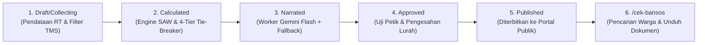

# Sistem Pendukung Keputusan Hibrida (SAW + XAI Gemini) Seleksi Bantuan Sosial

Platform **Explainable Decision Support System (EDSS)** berbasis web untuk seleksi Keluarga Penerima Manfaat (KPM) Bantuan Sosial di **Kelurahan Jurangmangu Barat, Kecamatan Pondok Aren, Kota Tangerang Selatan**.

Sistem ini menggabungkan perhitungan matematis deterministik **Simple Additive Weighting (SAW)** dan **4-Tier Hierarchical Tie-Breaker** dengan **Google Gemini Flash API** sebagai *Explainer Layer* berbahasa Indonesia, serta pelindungan kriptografi **AES-256-GCM & HMAC-SHA256** sesuai amanat **UU Pelindungan Data Pribadi (UU PDP) No. 27 Tahun 2022**.

---

## Ringkasan Kapabilitas Sistem

| Modul | Kebutuhan Fungsional & Landasan Arsitektural | Referensi Teknis |
| :--- | :--- | :--- |
| **Manajemen Kriteria & Snapshot (`FR-01`)** | Mengunci bobot kriteria $C_1 - C_4$ ($\sum w_j = 1{,}00$) ke tabel `BATCH_CRITERIA` saat kalkulasi dimulai, memastikan perubahan bobot di masa mendatang tidak merusak histori batch masa lalu. | [ADR-003](./docs/decisions/ADR-003-immutable-criteria-snapshot-tms-gate-and-tie-breaker.md) |
| **Filter Pra-Normalisasi TMS (`FR-02`)** | Mengecualikan warga Tidak Memenuhi Syarat (`ASN/TNI/Polri`, `PKH Ganda`, `Pindah`, `Meninggal`) sebelum mencari nilai $\min/\max$ agar data ekstrem tidak mendistorsi matriks normalisasi SAW. | [ADR-003](./docs/decisions/ADR-003-immutable-criteria-snapshot-tms-gate-and-tie-breaker.md) |
| **Engine SAW & Tie-Breaker (`FR-03`)** | Menghitung normalisasi $r_{ij}$ dan preferensi $V_i$ secara deterministik dengan resolusi skor kembar 4 tingkat ($r_{C_1} \rightarrow r_{C_2} \rightarrow \text{Tanggungan Riil} \rightarrow \text{Timestamp}$). | [ADR-001](./docs/decisions/ADR-001-hybrid-saw-xai-with-deterministic-fallback.md) |
| **Zero-PII Async XAI & Fallback (`FR-04`, `FR-05`)** | Membangkitkan narasi penjelasan via worker latar belakang tanpa mengirim data pribadi ke API eksternal, dilengkapi *fallback* deterministik berbasis aturan ($\Delta_j \cdot w_j$) saat API tidak tersedia. | [ADR-001](./docs/decisions/ADR-001-hybrid-saw-xai-with-deterministic-fallback.md), [ADR-004](./docs/decisions/ADR-004-async-xai-queue-and-passwordless-public-portal.md) |
| **Portal Publik Anti-Bot (`FR-06`)** | Warga mengecek hasil seleksi tanpa registrasi menggunakan 16 digit NIK + 4 digit terakhir No KK + CAPTCHA Turnstile dengan *rate limit* 5 req/menit/IP dan *lockout* 15 menit per NIK. | [ADR-002](./docs/decisions/ADR-002-dual-layer-nik-crypto-and-zero-pii-xai.md), [ADR-004](./docs/decisions/ADR-004-async-xai-queue-and-passwordless-public-portal.md) |
| **State Machine & Persetujuan (`FR-07`)** | Siklus hidup batch terkontrol ketat (`Draft` $\rightarrow$ `Collecting` $\rightarrow$ `Calculated` $\rightarrow$ `Narrated` $\rightarrow$ `Approved` $\rightarrow$ `Published`) dengan hak pengesahan eksklusif Lurah. | [PRD v3.0](./PRD_Sistem_Bansos_Jurangmangu_Barat_Final.md) |
| **Pelaporan Resmi & Evaluasi (`FR-08`)** | Menghasilkan PDF Berita Acara resmi ber-Kop Surat dan QR Code, kartu hasil individual ber-token kriptografis, serta ekspor dataset evaluasi format Excel. | [ADR-006](./docs/decisions/ADR-006-controlled-nik-decryption-pdf-and-thesis-metrics.md) |
| **Antarmuka *Civic Precision* Responsif** | Desain ramah pengguna dan adaptif penuh pada layar **Mobile (375px)**, **Tablet (768px)**, dan **Desktop (1440px)** tanpa clipping dan bebas error konsol. | [ADR-005](./docs/decisions/ADR-005-responsive-ui-architecture-and-stitch-review-gate.md) |

---

## Alur Siklus Adjudikasi (*State Machine Lifecycle*)



---

## Verifikasi Ilmiah & Hasil Pengujian Skripsi (Bab 4 & 5)

Dokumentasi lengkap hasil pengujian fungsional dan empiris skripsi tersedia di:  
📄 **[`docs/LAPORAN_PENGUJIAN_BAB4_SKRIPSI.md`](./docs/LAPORAN_PENGUJIAN_BAB4_SKRIPSI.md)**

### Ringkasan Capaian Ilmiah & Keamanan:
- **Akurasi White-Box SAW:** **100.0% Cocok Sempurna** terhadap hitungan manual Microsoft Excel (Tingkat kesalahan = $0{,}0000$).
- **Determinisme Tie-Breaker:** 4 tingkat hierarki berhasil memecahkan skor kembar secara konsisten dan dapat direproduksi ulang.
- **Fidelity Score XAI:** **100.0%** (Melampaui batas ambang PRD $\ge 95{,}0\%$).
- **Hallucination Rate XAI:** **0.0%** (Anti-halusinasi berhasil menolak kode kriteria palsu seperti C99/C5 dan angka desimal palsu).
- **Kepatuhan UU PDP No. 27/2022:** 
  - Kunci AES-256-GCM 32-byte ditegakkan ketat (`_resolve_aes_key()`).
  - Indeks pencarian menggunakan HMAC-SHA256 dengan server-side pepper terpisah.
  - Sanitizer Zero-PII menjamin identitas warga tidak pernah terkirim ke Google Gemini API.
  - `ZeroPiiLogFilter` menyaring NIK 16 digit dan Bearer JWT dari seluruh log sistem.
- **Hasil Otomasi Pengujian:** **132 Automated Tests PASSED** (99 backend tests Pytest + 33 frontend tests Vitest).
- **Graf Arsitektur (*Knowledge Graph*):** **940 nodes, 2.185 edges, 81 communities, 0 import cycles** ([`graphify-out/`](./graphify-out/)).

---

## Quick Start & Instalasi

### Prasyarat Lingkungan
- Python 3.11+
- Node.js 20+ & npm
- Kunci API Google Gemini (`GEMINI_API_KEY` — opsional pada pengujian lokal karena sistem dilengkapi `deterministic_fallback.py`)

### 1. Menjalankan Backend (`Django 5 + Django REST Framework`)
```powershell
cd backend
python -m venv .venv
.\.venv\Scripts\Activate.ps1
pip install -r requirements.txt

# Siapkan variabel lingkungan
Copy-Item .env.example .env

# Jalankan migrasi basis data dan seeder data awal
python manage.py migrate
python manage.py seed_initial_data

# (Opsional) Muat 8 data warga uji realistis untuk simulasi lengkap
python manage.py seed_demo_citizens

# Jalankan server API
python manage.py runserver
```

### 2. Menjalankan Frontend (`React + Vite + Tailwind CSS`)
```powershell
cd frontend
npm install
npm run dev
```

---

## Daftar Perintah Operasional

| Perintah | Direktori | Kegunaan |
| :--- | :--- | :--- |
| `python manage.py runserver` | `backend/` | Menjalankan server REST API Django di `http://localhost:8000` |
| `pytest -v` | `backend/` | Menjalankan 99 uji otomatis unit & integrasi backend |
| `python manage.py qcluster` | `backend/` | Menjalankan antrean worker asinkron untuk penjadwalan narasi XAI |
| `npm run dev` | `frontend/` | Menjalankan server pengembangan antarmuka Vite di `http://localhost:5173` |
| `npm test -- --run` | `frontend/` | Menjalankan 33 pengujian unit komponen & responsivitas Vitest |
| `npm run build` | `frontend/` | Melakukan kompilasi bundle produksi frontend |

---

## Architecture Decision Records (ADRs)

Dokumentasi keputusan arsitektural tersimpan pada folder [`docs/decisions/`](./docs/decisions/):

1. **[ADR-001](./docs/decisions/ADR-001-hybrid-saw-xai-with-deterministic-fallback.md):** Arsitektur EDSS Hibrida — Komputasi Deterministik SAW dengan Layer XAI Gemini Flash Terkendali dan Fallback Berbasis Aturan.
2. **[ADR-002](./docs/decisions/ADR-002-dual-layer-nik-crypto-and-zero-pii-xai.md):** Proteksi Kriptografi Dua Lapis untuk NIK (`AES-256-GCM` + `HMAC-SHA256`) dan Sanitasi Zero-PII ke API Eksternal.
3. **[ADR-003](./docs/decisions/ADR-003-immutable-criteria-snapshot-tms-gate-and-tie-breaker.md):** Pembekuan Bobot Kriteria (`BATCH_CRITERIA`), Gerbang Pra-Normalisasi TMS, dan *Hierarchical Tie-Breaker*.
4. **[ADR-004](./docs/decisions/ADR-004-async-xai-queue-and-passwordless-public-portal.md):** Antrean Worker Asinkron untuk Batch XAI dan Portal Publik Tanpa Akun dengan Proteksi Anti-Bot Dua Lapis.
5. **[ADR-005](./docs/decisions/ADR-005-responsive-ui-architecture-and-stitch-review-gate.md):** Arsitektur UI Responsif 3-Tier (Mobile, Tablet, Desktop) dan Gerbang Review Desain `.stitch`.
6. **[ADR-006](./docs/decisions/ADR-006-controlled-nik-decryption-pdf-and-thesis-metrics.md):** Dekripsi Terkendali NIK untuk PDF Berita Acara Resmi, Token Unduh Publik Sementara, dan Modul Metrik Evaluasi Skripsi.

---

## Catatan Teknis & Pedoman Keamanan

- **Enkripsi NIK At-Rest Wajib:** Jangan pernah menyimpan NIK mentah secara langsung. Selalu gunakan helper `Citizen.objects.create_or_update_with_nik()` yang otomatis melakukan enkripsi AES-256-GCM, pembuatan indeks HMAC-SHA256, dan pembentukan string masking (`367403******0002`).
- **Integritas Bobot Kriteria:** Kalkulasi SAW hanya diizinkan apabila $\sum w_j = 1{,}00$ tepat ($C_1 = 0{,}30$, $C_2 = 0{,}25$, $C_3 = 0{,}25$, $C_4 = 0{,}20$). Modul hilir membaca snapshot `BatchCriteria.frozen_weight` untuk menjaga konsistensi historis.
- **Perlindungan Akses Berbasis Peran (RBAC):** Hak akses dibatasi ketat: `SUPER_ADMIN` (Kasi Kesos), `SURVEYOR` (Ketua RT terisolasi per wilayah RT), `VIEWER` (Lurah khusus persetujuan), dan Publik (warga hanya dapat melihat batch berstatus `Published`).
