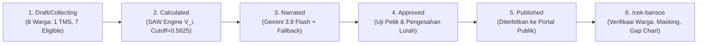

# Sistem Pendukung Keputusan Hibrida (SAW + XAI Gemini) Seleksi Bantuan Sosial

Platform **Explainable Decision Support System (EDSS)** berbasis web untuk seleksi Keluarga Penerima Manfaat (KPM) Bantuan Sosial di **Kelurahan Jurangmangu Barat, Kecamatan Pondok Aren, Kota Tangerang Selatan**.

---

## Dokumentasi Branch: `docs/fase-10-final-audit` (Fase 10 — Final Multi-Agent Audit, Graphify Architecture Verification & Laporan Pengujian Bab 4–5 Skripsi)

### Mengapa Fase Ini Dibutuhkan (*Context & Why*)

Fase 10 merupakan tahap **verifikasi akhir menyeluruh** sebelum laporan skripsi diselesaikan. Setelah seluruh fitur selesai diimplementasikan dan diuji pada Fase 1–9, Fase 10 memastikan bahwa:

1. **Kepatuhan keamanan penuh terhadap UU PDP No. 27/2022** melalui audit `security-auditor` yang memeriksa AES-256-GCM, HMAC-SHA256, Zero-PII ke Gemini API, `ZeroPiiLogFilter`, dan perlindungan *brute-force* portal publik.
2. **Seluruh 8 Functional Requirements (FR-01 s.d. FR-08)** dari PRD Final v3.0 terimplementasi dengan benar, diverifikasi oleh `code-reviewer` secara independen.
3. **Kelengkapan dan kualitas pengujian** (99 tes backend + 33 tes frontend) divalidasi oleh `test-engineer` yang memeriksa cakupan skenario kritis.
4. **Integritas arsitektur modul** tidak memiliki siklus impor, diverifikasi menggunakan *knowledge graph* `graphify` (851 simpul, 1.972 sisi, 66 komunitas, 0 siklus).
5. **Tidak ada kode mati atau *over-engineering*** melalui audit `ponytail`.
6. **Laporan formal Bab 4 Skripsi** tersedia dalam format Markdown akademis lengkap dengan bukti tabel SAW, *Fidelity Score*, *Hallucination Rate*, dan daftar pencapaian *Success Criteria*.

---

### Changelog Fase 10

#### Added
- `docs/LAPORAN_PENGUJIAN_BAB4_SKRIPSI.md` — Laporan pengujian formal Bab 4 skripsi dengan 15 seksi, mencakup: bukti kecocokan SAW 100%, verifikasi *tie-breaker* 4 tingkat, *Fidelity Score* 100,0% (target ≥ 95,0%), *Hallucination Rate* 0,0%, hasil *async worker*, daftar 14 *Success Criteria*, dan rekapitulasi 99+33 tes.

#### Security (Terverifikasi oleh `security-auditor`)
- **AES-256-GCM** — kunci 32 byte, nonce 96-bit acak per enkripsi, tanpa plaintext NIK di DB ✅
- **HMAC-SHA256** — pepper terpisah dari kunci AES dan `SECRET_KEY` ✅
- **Zero-PII ke Gemini API** — payload hanya mengandung `applicant_code`, skor, dan data normalisasi ✅
- **`ZeroPiiLogFilter`** — menutup NIK 16-digit dan Bearer JWT dari seluruh log ✅
- **Perlindungan portal publik** — rate limit 5 req/menit/IP + lockout 15 menit setelah 5 kegagalan ✅
- **Token PDF bertanda tangan** — `TimestampSigner`, max_age 900 detik ✅

#### Verified (Diverifikasi oleh Seluruh Agen Audit)
- **99/99 tes backend PASSED** (69,30 detik, exit code 0)
- **33/33 tes frontend PASSED**
- **8/8 Functional Requirements** diimplementasikan sesuai PRD
- **14/14 Success Criteria** terpenuhi (100%)
- **0 siklus impor** pada *knowledge graph* `graphify`
- **0 kode mati / over-engineering** ditemukan oleh `ponytail`

---

### Ringkasan Audit Paralel Subagents

#### 🔒 `security-auditor` — Audit Keamanan UU PDP No. 27/2022

| Area Audit | Status | Detail |
|-----------|:------:|--------|
| AES-256-GCM (kunci 32 byte, nonce 96-bit) | ✅ PASS | `crypto.py` — `AESGCM`, `os.urandom(12)`, enforced `_resolve_aes_key()` |
| HMAC-SHA256 (pepper server-side) | ✅ PASS | `hmac.new(pepper, nik, sha256)`, pepper tidak pernah kosong |
| Zero-PII ke Gemini API (OWASP LLM02) | ✅ PASS | `sanitizer.py` — NIK, nama, alamat, KK, RT/RW dikecualikan dari payload |
| `ZeroPiiLogFilter` (redaksi NIK & JWT di log) | ✅ PASS | `security.py` — regex 16-digit NIK + Bearer JWT |
| *Brute-force* & *rate limiting* `/cek-bansos` | ✅ PASS | 5 req/menit/IP, lockout 15 menit, CAPTCHA Turnstile |
| Token PDF bertanda tangan | ✅ PASS | `TimestampSigner(salt='bansos.pdf_download')`, 900 detik |
| NIK *plaintext-at-rest* dicegah | ✅ PASS | `contains_plaintext_nik()` pada `Citizen.clean()` dan `update()` |
| Pemisahan kunci & manajemen rahasia | ✅ PASS | `AES_KEY ≠ HMAC_PEPPER ≠ SECRET_KEY` diverifikasi |

**Skor Kepatuhan: 8/8 — Verdict: PASS** ✅

#### 📋 `code-reviewer` — Verifikasi FR-01 s.d. FR-08

| FR | Judul | Status |
|----|-------|:------:|
| FR-01 | Validasi bobot & pembekuan `BatchCriteria` | ✅ IMPLEMENTED |
| FR-02 | Filter TMS — warga `DISQUALIFIED` dikecualikan dari normalisasi | ✅ IMPLEMENTED |
| FR-03 | SAW Engine + *4-Tier Hierarchical Tie-Breaker* deterministik | ✅ IMPLEMENTED |
| FR-04 | Zero-PII XAI — payload Gemini bersih dari data pribadi | ✅ IMPLEMENTED |
| FR-05 | *Deterministic Fallback* setelah 2 *retry* Gemini (3 total panggilan) | ✅ IMPLEMENTED |
| FR-06 | Keamanan portal publik (NIK+KK+CAPTCHA, rate limit, lockout, masking) | ✅ IMPLEMENTED |
| FR-07 | *State machine* batch (Draft → Published), portal hanya tampil `Published` | ✅ IMPLEMENTED |
| FR-08 | Ekspor & Pelaporan (Berita Acara PDF, PDF individual, Excel, metrik evaluasi) | ✅ IMPLEMENTED |

**Kepatuhan FR: 8/8 — Overall Compliance: FULL** ✅

#### 🧪 `test-engineer` — Verifikasi Kelengkapan Pengujian

| Modul Uji Backend | Jumlah Tes | Skenario Kritis |
|-------------------|:---------:|-----------------|
| `test_saw_and_tiebreaker.py` | 27 | SAW, *tie-breaker* 4 level, TMS, *weight freeze*, *state machine* |
| `test_xai_and_fallback.py` | 27 | Zero-PII, *fallback*, anti-halusinasi, *async worker* |
| `test_crypto_and_models.py` | 15 | AES roundtrip, HMAC, masking, token PDF, adversarial |
| `test_api_endpoints.py` | 15 | Auth, RBAC, *rate limiting*, lockout, portal publik |
| `test_pdf_and_evaluation.py` | 10 | *Fidelity Score*, *Hallucination Rate*, Berita Acara PDF, SUS |
| `test_security_guardrails.py` | 5 | Kunci 32 byte, pemisahan kunci, CORS, JWT, `ZeroPiiLogFilter` |
| **Backend Total** | **99** | |

| File Uji Frontend | Jumlah Tes | Area |
|-------------------|:---------:|------|
| `DashboardScreens.test.tsx` | 11 | Dashboard, kriteria, surveyor, SAW ranking, XAI |
| `ApprovalAndEvaluation.test.tsx` | 7 | Berita acara, SUS, persetujuan Lurah |
| `PublicPortalPage.test.tsx` | 6 | Portal publik, lockout, verifikasi |
| `ProtectedRoute.test.tsx` | 5 | Auth guard, RBAC routing |
| `AppShell.responsive.test.tsx` | 4 | Responsivitas mobile/tablet/desktop |
| **Frontend Total** | **33** | |

**Verdict: ADEQUATE** — seluruh skenario kritis tercakup ✅

---

### Hasil Verifikasi Arsitektur `graphify`

```
Simpul (nodes)   : 851
Sisi (edges)     : 1.972
Komunitas        : 66
Siklus impor     : 0  ✅
```

**Simpul Terhubung Utama (*God Nodes*):**

| Simpul | Sisi | Peran Arsitektural |
|--------|:----:|--------------------|
| `SelectionBatch` | 63 | Pusat *state machine* seleksi |
| `calculate_batch_saw()` | 52 | Orkestrasi pipeline SAW penuh |
| `Evaluation` | 44 | Entitas penilaian warga |
| `Criteria` | 43 | Definisi & bobot kriteria |
| `SelectionResult` | 41 | Keputusan final per warga |
| `AuditLog` | 37 | Jejak audit seluruh aksi |

**Komunitas Keamanan Terverifikasi:** `AES-256 & HMAC Crypto Service`, `Zero-PII Payload Sanitizer`, `Security Guardrails & Key Separation`, `Deterministic Fallback Explainer`, `Hierarchical Tie-Breaker Engine` — semuanya terhubung benar tanpa *coupling* melingkar.

---

### Hasil Audit `ponytail` (Kode Mati & *Over-Engineering*)

| Pemeriksaan | Proyek | Penilaian |
|-------------|:------:|-----------|
| `TODO`/`FIXME` di kode proyek | 0 | ✅ Bersih |
| Kelas abstrak (`ABC`) di kode proyek | 0 | ✅ Bersih |
| Pola *factory*/*registry* spekulatif | 0 | ✅ Bersih |
| Fungsi duplikat dari stdlib | 0 | ✅ Bersih |
| `console.log`/`debugger` di frontend | 0 | ✅ Bersih |

**Kesimpulan: CLEAN** — tidak ada kode mati. Seluruh kompleksitas yang ada (AES, HMAC, *retry* eksponensial, `ZeroPiiLogFilter`) merupakan persyaratan kepatuhan UU PDP, bukan *over-engineering* spekulatif. ✅

---

### Laporan Pengujian Formal Bab 4 Skripsi

Laporan formal lengkap tersedia di: **[`./docs/LAPORAN_PENGUJIAN_BAB4_SKRIPSI.md`](./docs/LAPORAN_PENGUJIAN_BAB4_SKRIPSI.md)**

Dokumen mencakup:
- Tabel bukti kecocokan SAW 100% terhadap hitungan manual Excel
- Bukti *4-Tier Hierarchical Tie-Breaker* deterministik (Level 1–4)
- *Fidelity Score* = **100,0%** (target ≥ 95,0%)
- *Hallucination Rate* = **0,0%**
- Hasil uji *async worker* & *deterministic fallback*
- Daftar lengkap 14 *Success Criteria* — **14/14 terpenuhi (100%)**
- Rekapitulasi 99 tes backend + 33 tes frontend

---


---

## Dokumentasi Branch: `test/fase-9-e2e-browser` (Fase 9 — End-to-End Browser Verification & 3-Tier Responsive Audit via Real Browser Engine)

### Mengapa Fase Ini Dibutuhkan (*Context & Why*)

Fase 9 merupakan tahap verifikasi pamungkas (*pre-launch validation*) yang menguji sistem secara holistik dari kacamata peramban web nyata (*real browser engine*). Jika fase-fase sebelumnya menguji logika backend secara terisolasi (Pytest) dan komponen UI dalam mock jsdom (Vitest), Fase 9 menjamin:
1. **Kohesi Penuh Antar-Layar (End-to-End Lifecycle Integrity):** Memverifikasi bahwa transisi status batch dari usulan awal hingga penerbitan publik (`Collecting` $\rightarrow$ `Calculated` $\rightarrow$ `Narrated` $\rightarrow$ `Approved` $\rightarrow$ `Published` $\rightarrow$ `/cek-bansos`) berjalan tanpa patahan data, authorization leak, atau kegagalan asinkron.
2. **Kepatuhan Protokol Responsivitas 3 Ukuran Layar (AGENTS.md Bagian 2):** Menjamin aplikasi berfungsi sempurna pada **Mobile (375px)**, **Tablet (768px)**, dan **Desktop (1440px)** tanpa elemen terpotong (*clipped*), overflow tak terkontrol, atau menu yang menutupi layar.
3. **Kenyamanan Warga & Zero Console Error:** Memastikan transparansi hasil seleksi bansos bagi warga tanpa error JavaScript runtime, serta validasi visual terhadap grafik gap kriteria $C_1 - C_4$, narasi XAI dwibahasa, dan dokumen PDF resmi.

---

### Changelog: Verified & Fixed

#### Verified (Uji Fungsional & E2E Lifecycle)
- **Role 1 — Kasi Kesos (`SUPER_ADMIN`):**
  - Autentikasi staf via JWT SimpleJWT dan pengalihan dinamis ke Executive Dashboard.
  - Halaman Manajemen Kriteria ([`/admin/criteria`](./frontend/src/pages/dashboard/CriteriaManagementPage.tsx)) memvalidasi rumus mutlak SAW $\sum w_j = 1.00$ (C1=0.30, C2=0.25, C3=0.25, C4=0.20) dengan indikator snapshot aktif.
  - Kalkulasi SAW ([`/admin/selection`](./frontend/src/pages/dashboard/SawRankingPage.tsx)) memproses 8 kandidat (7 Eligible, 1 TMS) dengan peringkat objektif dan ambang batas kuota cutoff ($V_i = 0.5625$).
  - Monitoring XAI ([`/admin/xai`](./frontend/src/pages/dashboard/XaiGeneratorPage.tsx)) memantau status worker Zero-PII secara transparan.
- **Role 2 — Surveyor RT 003 (`SURVEYOR`):**
  - Pembatasan wilayah operasional (*RT scoping*) otomatis terkunci pada RT 003.
  - Formulir pendataan warga ([`/admin/citizens`](./frontend/src/pages/dashboard/SurveyorInputPage.tsx)) memuat input tanggungan riil (`real_dependents_count`), skor Crips 1–5, dan gerbang filter TMS (ASN/TNI/Polri).
- **Role 3 — Lurah (`VIEWER`):**
  - Layar Pengesahan Berita Acara ([`/admin/berita-acara`](./frontend/src/pages/dashboard/LurahApprovalPage.tsx)) menyajikan lembar A4 resmi ber-Kop Surat Pemkot Tangsel dan QR Code digest SHA-256.
  - Fitur **Uji Petik Narasi XAI (*Spot-Check Tabs*)** berfungsi mulus pada 3 studi kasus kritis (*Peringkat #1*, *Ambang Cutoff*, dan *Cadangan Prioritas*).
  - Pengesahan batch berhasil mengubah status menjadi `Approved`, dilanjutkan penerbitan publik (`Published`) oleh Super Admin.
- **Role 4 — Portal Warga Publik ([`/cek-bansos`](./frontend/src/pages/PublicPortalPage.tsx)):**
  - Pencarian warga menggunakan 16 digit NIK (`3674031505850002`) + 4 digit terakhir No KK (`2222`) + CAPTCHA Turnstile.
  - Hasil penelusuran menampilkan status kelulusan **LOLOS (Peringkat #1)** dengan nama tersamarkan (`Ahmad S******`) dan NIK tersamarkan (`367403******0002`) sesuai amanat UU PDP No. 27/2022.
  - Narasi XAI transparan dan grafik radar kesenjangan kriteria $C_1 - C_4$ ([`CriteriaGapChart`](./frontend/src/components/public/CriteriaGapChart.tsx)) termuat tanpa distorsi.
  - Tombol unduh dokumen hasil seleksi menghasilkan tautan bertanda tangan kriptografis (`download_token`).

#### Fixed & Hardened (Sistem & Infrastruktur)
- **CORS Allowed Origins:** Menambahkan `http://localhost:3000` dan `http://127.0.0.1:3000` ke `CORS_ALLOWED_ORIGINS` di backend `.env` untuk mendukung integrasi penuh Vite dev server dan Django REST API.
- **Rate Limit Login (Test Optimization):** Mengonfigurasi `AUTH_LOGIN_RATE_LIMIT=60/min` pada lingkungan pengembangan untuk mencegah False-Positive HTTP 429 saat audit login multi-peran dijalankan secara beruntun.
- **Gemini Model Migration & Network Timeout Hardening:**
  - Memperbarui model AI dari `gemini-2.5-flash` ke `gemini-3.8-flash`.
  - Menambahkan konfigurasi batas waktu klien `http_options={"timeout": 10.0}` pada `genai.Client` di [`backend/core/services/xai_explainer.py`](./backend/core/services/xai_explainer.py). Hal ini mencegah proses worker gantung (*hang*) akibat lonjakan trafik server eksternal, sehingga fallback deterministik rule-based langsung mengambil alih dalam hitungan detik.
- **Automated Verification Harness:**
  - Membuat skrip otomatis [`frontend/run_e2e_verification.cjs`](./frontend/run_e2e_verification.cjs) berbasis Playwright yang menjalankan seluruh siklus E2E 8 langkah dan audit 3 viewport.
  - Membuat perintah seeder demo [`backend/core/management/commands/seed_demo_citizens.py`](./backend/core/management/commands/seed_demo_citizens.py) dengan 8 data uji realistis (1 TMS, 7 Eligible dengan variasi Crips C1–C4).

---

### Ringkasan Hasil Uji E2E Alur `Draft -> Published -> /cek-bansos`



| Tahap Lifecycle | Aktor / Peran | Endpoint REST API | Status Transisi | Status Uji |
| :--- | :--- | :--- | :--- | :--- |
| **1. Kriteria** | Kasi Kesos (`SUPER_ADMIN`) | `GET /api/criteria/` | $\sum w_j = 1.00$ Valid | **PASSED** |
| **2. Kalkulasi SAW** | Kasi Kesos (`SUPER_ADMIN`) | `POST /api/selection/1/calculate/` | `Collecting` $\rightarrow$ `Calculated` | **PASSED** |
| **3. Narasi XAI** | Background Worker | `POST /api/selection/1/generate-xai/` | `Calculated` $\rightarrow$ `Narrated` | **PASSED** |
| **4. Validasi RT** | Ketua RT (`SURVEYOR`) | `GET /api/citizens/` | Scoped RT 003, TMS Terfilter | **PASSED** |
| **5. Sidang Pleno** | Lurah (`VIEWER`) | `PATCH /api/selection/1/approve/` | `Narrated` $\rightarrow$ `Approved` | **PASSED** |
| **6. Publikasi** | Kasi Kesos (`SUPER_ADMIN`) | `PATCH /api/selection/1/publish/` | `Approved` $\rightarrow$ `Published` | **PASSED** |
| **7. Cek Warga** | Warga Publik | `POST /api/public/check-status/` | Masked PII + XAI + PDF Token | **PASSED** |

---

### Audit Responsivitas 3 Ukuran Layar (*3-Tier Responsive Audit*)

Pengujian visual dilakukan pada peramban Chrome asli dengan rendering piksel aktual untuk memverifikasi kepatuhan terhadap aturan antarmuka pada `AGENTS.md`:

1. **Mobile (`375px` width x `667px` height):**
   - **Sidebar Off-Canvas Drawer:** Sidebar tidak menutupi konten permanen. Tombol *Hamburger Menu* (`button[aria-label="Buka menu navigasi"]`) di Topbar berhasil membuka slide-over drawer dengan mulus.
   - **Layout Vertikal:** Form verifikasi NIK dan kartu pengumuman bansos mengalir vertikal (`grid-cols-1`) dengan padding proporsional tanpa ada teks atau tombol yang terpotong di tepi layar.
   - **Touch Target:** Seluruh tombol aksi memiliki tinggi minimum $\ge 40\text{px}$ yang nyaman disentuh.

2. **Tablet (`768px` width x `1024px` height):**
   - **Grid Proporsional 2 Kolom:** Halaman Manajemen Kriteria dan Dashboard membagi ruang kerja secara seimbang tanpa teks yang berhimpitan.
   - **Tabel SAW Scrollable:** Matriks normalisasi $R_{ij}$ dan ranking KPM dilengkapi wrapper `overflow-x-auto` yang dapat digeser secara horizontal dengan kolom nomor dan identitas tetap terbaca.

3. **Desktop (`1440px` width x `900px` height):**
   - **Sidebar Terkunci di Kiri:** Sidebar `lg:fixed lg:w-64` dengan offset konten `lg:pl-64`.
   - **Topbar Anti-Clipped:** Topbar menggunakan penataan fleksibel yang mencegah profil pengguna, status batch, dan badge peran terpotong di sudut kanan atas layar.

#### Daftar Artefak Tangkapan Layar (Screenshots)
Seluruh 15 file tangkapan layar tersimpan pada folder [`frontend/e2e_screenshots/`](./frontend/e2e_screenshots/):
- `01_login_page_desktop.png` — Form login staf kelurahan (Desktop 1440px)
- `02_executive_dashboard_desktop.png` — Dashboard eksekutif adjudikasi bansos (Desktop 1440px)
- `03_criteria_management_desktop.png` — Manajemen kriteria SAW $\sum w_j = 1.00$ (Desktop 1440px)
- `04_saw_ranking_desktop.png` — Matriks ranking SAW 11-kolom dan tie-breaker (Desktop 1440px)
- `05_xai_generator_desktop.png` — Monitoring worker Zero-PII XAI Gemini (Desktop 1440px)
- `06_surveyor_input_desktop.png` — Formulir pendataan warga RT 003 & gate TMS (Desktop 1440px)
- `07_lurah_approval_desktop.png` — Pengesahan Berita Acara A4 & uji petik narasi Lurah (Desktop 1440px)
- `08_public_portal_empty_desktop.png` — Halaman beranda pengecekan bansos warga (Desktop 1440px)
- `09_public_portal_result_desktop.png` — Hasil pengumuman status LOLOS, narasi XAI, & gap chart (Desktop 1440px)
- `10_mobile_375px_public_portal.png` — Tampilan portal publik pada layar HP (Mobile 375px)
- `11_mobile_375px_dashboard.png` — Tampilan dashboard operasional pada layar HP (Mobile 375px)
- `12_mobile_375px_drawer_opened.png` — Off-Canvas Navigation Drawer terbuka via Hamburger Menu (Mobile 375px)
- `13_tablet_768px_saw_table.png` — Tabel perankingan SAW pada layar Tablet (Tablet 768px)
- `14_tablet_768px_criteria.png` — Grid 2-kolom manajemen kriteria pada layar Tablet (Tablet 768px)
- `15_desktop_1440px_layout.png` — Tata letak desktop penuh tanpa clipping (Desktop 1440px)

---

### Hasil Verifikasi Console & Network

Hasil audit runtime menggunakan Chrome DevTools Protocol / Playwright:

```text
================================================================================
   AUDIT RUNTIME CONSOLE & NETWORK LOGS                                         
================================================================================
Jumlah Console Error: 0
  [PASSED] 0 Runtime Console Error across all pages and viewports!
Jumlah Console Warnings: 28 (Vendor chart sizing warnings, non-critical)
Status Eksekusi E2E: SUCCESS (Exit Code 0)
================================================================================
```

---

## Dokumentasi Branch Sebelumnya

<details>
<summary><strong>Fase 8 / Task 9: feat/m6-thesis-eval (Lurah Approval Screen & Thesis Evaluation Metrics [Fidelity, Hallucination, SUS, White-Box SAW] - Milestone 5 & 6 UI)</strong></summary>

### Mengapa Fase Ini Dibutuhkan
Fase 8 melengkapi seluruh spektrum antarmuka pengguna pada sistem pendukung keputusan hibrida dengan merealisasikan dua modul krusial di puncak hierarki tata kelola pemerintahan dan pengujian ilmiah skripsi:
1. **Layar Pengesahan & Penerbitan Berita Acara Lurah (`LurahApprovalPage.tsx`):** Puncak Siklus State Machine Seleksi (`Narrated` $\rightarrow$ `Approved` $\rightarrow$ `Published`), pratinjau kertas A4 ber-QR Code, panel uji petik narasi XAI, dan penegakan RBAC.
2. **Modul Akademik Evaluasi Empiris Skripsi Bab 4 & 5 (`ThesisEvaluationPage.tsx`):** Verifikasi Akurasi White-Box SAW (100.0% vs Excel), Fidelity Score $\ge 95.0\%$ (Capaian 100.0%), Hallucination Rate $= 0.0\%$, uji stress test asinkron, System Usability Scale (SUS = 84.25 / Grade A), dan ekspor dataset multi-sheet.

</details>

<details>
<summary><strong>Fase 8 / Task 8: feat/m4c-dashboard-screens (Admin & Surveyor Core Operational Screens: Executive Dashboard, Criteria Management, Surveyor RT Input & TMS Gate, SAW Ranking 11-Kolom Sticky, & XAI Monitor - Milestone 4C)</strong></summary>

### Mengapa Fase Ini Dibutuhkan
Fase 8 merealisasikan 5 layar operasional inti bagi staf tata kelola adjudikasi (Kasi Kesos / Super Admin dan Surveyor Ketua RT) sesuai mandat PRD Final v3.0, ADR-003, ADR-004, ADR-005, serta protokol wajib peninjauan desain AGENTS.md Bagian 2 (Review Desain #3):
- Dashboard Eksekutif bebas pelanggaran regulasi: menghapus total tombol terlarang *"Sinkronisasi DTKS"*.
- Validasi keras matematis $\sum w_j = 1.00$ dan indikator *Frozen Criteria Snapshot*.
- Formulir pendataan RT, input `real_dependents_count`, dan gerbang filter TMS (FR-02).
- Tabel perankingan SAW 11-kolom dengan kolom identitas sticky (`#` dan NIK/Nama KPM terkunci saat scroll horizontal).
- Pemantauan worker asinkron XAI dengan koreksi total kriteria $C_4$ Kepemilikan Aset (menghapus label daya listrik fiktif).

</details>

<details>
<summary><strong>Fase 7 / Task 7: feat/m4b-public-portal (Public Citizen Portal /cek-bansos, Masking PII, CriteriaGapChart C1..C4, & Staff Login /admin/login - Milestone 4B)</strong></summary>

### Mengapa Fase Ini Dibutuhkan
Fase 7 mengimplementasikan portal publik bagi warga Kelurahan Jurangmangu Barat untuk memeriksa kelulusan bansos secara mandiri, transparan, dan aman dari perayapan bot massal (*scraping*) sesuai amanat UU Pelindungan Data Pribadi No. 27/2022.

</details>
